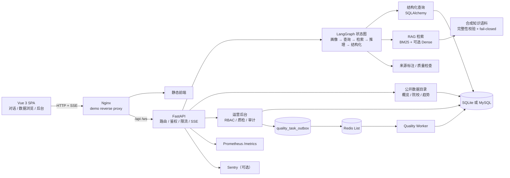

# Gaobao Advisor｜可核验的高考志愿辅助决策系统

> **Memory 专项定位（2026-11-24）**：统一对话上下文、可选语义压缩、版本化 Session Snapshot 和独立的用户偏好机制；后两者受开关、隐私与 CI 门禁约束，不能用历史摘要代替招生 SQL 证据。见 [Memory 专项工程定位](docs/architecture/memory-engineering-positioning-20261124.md)。

**AI 应用全栈交付 + 可信数据查询 + Agent 运行时可靠性实验**

围绕“考生如何在信息不完整时获得可追溯、可解释的志愿咨询结果”，实现 **画像追问 → 结构化 SQL 查询 → 合成知识检索 → 来源/风险检查 → SSE 交互** 的端到端业务链路。工程上包含 Vue 3、FastAPI、受约束的 LangGraph 工作流，以及可选的 Java Gateway、MySQL、Redis、Docker Compose 和 CI 集成验证。

**Agent Harness 工程实验**独立于生产问答路由：用真正的只读业务工具检验模型/Planner 的多步工具执行、预算控制、Fail-Closed 和离线 Eval，不将使用框架或通过单测等同于业务成功。

> **代码归属：** 基于上游早期 MIT 许可代码继续二次开发与工程加固，保留原始许可声明；具体见 [第三方归属说明](THIRD_PARTY_NOTICES.md)。

> **数据边界先行：** 仓库默认只附带程序生成的 **SYNTHETIC_DEMO** 合成演示数据，不对应任何真实院校、专业或录取结果，**不可用于真实志愿决策**。真实数据导入能力保留在源码中，使用者需自行提供合法授权数据。

[](https://github.com/Xander-Xai/gaobao-advisor/actions/workflows/ci.yml)
[](https://github.com/Xander-Xai/gaobao-advisor/actions/workflows/codeql.yml)
[](LICENSE)
[](DATA_LICENSE.md)


**目录：** [Agent Harness 实验](#agent-harness--eval-实验) · [项目预览](#项目预览) · [核心功能](#核心功能) · [系统架构](#系统架构) · [技术栈](#技术栈) · [快速开始](#快速开始) · [数据说明](#数据说明) · [功能演示](#功能演示) · [开发与测试](#开发与测试) · [已知限制](#已知限制) · [Roadmap](#roadmap) · [License](#license)

---

## 会话上下文管理（独立于跨任务长期记忆）

在线对话的同步、传统流式和公开 SSE 最终候选生成，使用统一的
`server/agent/chat_context.py` 来限制历史上下文并保留本轮 SQL/RAG 来源。
默认只保留最近 20 轮并显式标记丢失的旧历史；需要语义压缩时，可在**授权的开发环境**
开启 `GAOBAO_CHAT_COMPACTION_ENABLED=true`，再由现有 `MemoryManager`
对旧历史按需摘要、保留最近 10 轮。摘要是**未经核验的用户对话线索**，不构成招生证据或工具审批。

该开关默认关闭，因为启用后每次满足条件的请求可能增加模型调用费用。
摘要目前不持久化，不具备 Pi/OpenCode 的完整会话分叉与增量恢复机制，
也没有真实模型 A/B、Token 降本证明或生产个人信息许可。
操作及负控制验收见 [Pi/OpenCode-inspired Session Compaction](docs/validation/pi-opencode-session-compaction-20261124.md)。
跨任务用户偏好记忆仍在独立 Draft PR #135，不应与会话压缩混同。

进一步的**可复用会话摘要快照**已在独立堆叠 Draft 中实现：将摘要按会话主键、历史前缀 SHA、策略版本和 TTL 存储，增量变化先保留原文，再触发更新。仍需单独授权开关 `GAOBAO_CHAT_SNAPSHOT_ENABLED=true`，且当前明确禁止生产环境启用；具体限制与 Alembic 迁移冲突见 [Session Compaction Snapshot](docs/validation/session-compaction-snapshot-20261124.md)。

## Agent Harness / Eval 实验

与现有 17 节点业务图**分离**的只读执行层，位于 `server/agent/readonly_harness.py`、`readonly_model_planner.py` 和 `readonly_tools.py`。这里实现的是 **Planner → Tool → Observation → Finish/Abstain** 的受约束循环，不是把业务 LangGraph 节点数当成“工具步长”。

| 可验证能力 | 代码与验收 |
|---|---|
| 工具治理 | 4 个只读合成数据/知识服务；严格参数类型、来源和工具白名单 |
| 长步数约束 | 8 模型步、5 工具调用、同参最多 2 次；显式错误原因与安全拒答 |
| Token / 上下文 | provider 返回的 Token 可累计、超预算阻断；未知用量明确 `null`；限制观测窗口 |
| 可重复 Eval | 30 条显式合成用例（22 正常、8 负控制）与 24 个独立院校/专业事实断言 |
| 可选真实模型探针 | `benchmarks/readonly_model_eval.py`，必须显式授权网络和 API 费用，默认 CI 不运行 |

### 模型自主工具选择与业务级对照（P5，默认不调用模型）

前几轮的后台历史决策卡采用 `DETERMINISTIC_OBSERVATION_POLICY_NOT_LLM`；本轮追加**真正可插入模型决策器的同一任务执行链路**，而非把另外的脚本叫成 Agent：

- `server/agent/decision_card_model_planner.py`：真实 OpenAI-compatible 模型可根据先前 SQL 工具观察决定下一步 `major_lookup`、`admission_lookup`、`plan_lookup`，或拒答/结束；绝不允许模型自行执行任意 SQL、Shell、联网、访问真实学校或修改系统数据。
- 工具参数必须与**事先冻结的合成考生画像精确一致**；重复调用、提前结束、无来源结束、外部工具和提供方 Token 缺失均会拒绝；模型不能直接撰写最终学校分数/位次，卡片仍从实际 SQLite 结果独立生成。
- `benchmarks/decision_card_business_eval.py`：八个固定合成场景（开发 4、Holdout 4）采用**相同的独立 SQL/ORM 真值评分**，对比确定性基线与可选模型决策。完整成功需通过准确结果、来源哈希与证据完整性；缺失场景要实际观察到证据缺口后拒答，不能靠一律拒答作弊。
- 报告分别记录任务成功、合理拒答、工具/模型步数、实际 provider-reported Token、耗时和运行失败类别。**合成案例未经真实人工审批，不是现实高考准确率的 Ground Truth。**

可在没有任何外部模型费用的本地/CI 环境复现**确定性基线**：

```bash
python -m benchmarks.decision_card_business_eval --out /tmp/gaobao-business-baseline.json
```

**只有明确同意外部模型调用、自己配置提供商 API Key 和限制预算后**才运行真实模型；示例（请先确认密钥与费用）：

```bash
export OPENAI_API_KEY='your-own-secret'  # 不要提交到仓库或 CI artifact
# 如使用 OpenAI-compatible 兼容服务，可额外设 OPENAI_API_BASE
python -m benchmarks.decision_card_business_eval \
  --mode model --model YOUR_MODEL_ID --permit-external-model \
  --max-cases 8 --out /tmp/gaobao-business-real-model.json
```

默认模式完全不导入提供商 SDK；CI 也**不会**自动花钱或使用你的私钥。`tests/test_decision_card_model_planner.py` 的 Fake client 只测协议与真实数据库工具联调，**不能代表实际 LLM 任务成功率**。业务 API 的 `/decision-card` 仍是纯确定性策略、默认关闭且仅运营人员可用；模型版目前为隔离 CLI 实验，未接入面向用户的在线路由。

**关于比较口径**：确定性策略不产生 provider Token，模型 Token 与零模型基线之间不是公平的 LLM 成本优化对照。若要声称 Prompt/Skill 改造降低 Token，必须对**同一模型**、冻结 Holdout 的改造前后版本做多次真实调用、计入失败与价格口径，并通过独立审核后才能落到简历。

### 有业务约束的合成考生决策卡（P4，默认关闭）

这项增量把此前“查两所学校属于哪个省”的简单演示升级为**需要真实合成数据库多次查询、结果交叉验证和拒答**的任务。仍然属于运营台隔离实验，不面向真实考生。

**输入**：两所事先声明的虚构院校、一个虚构专业、虚构省份、合成分数、物理类/历史类与最新合成年份。**工具链**：`major_lookup`（专业门类）、`admission_lookup` ×2（录取分数/位次及历史选科类别）、`plan_lookup` ×2（招生计划/选科要求），每次都通过现有数据库真实查询，并按数据行生成来源指纹，而不是让模型编造数字。

**输出**：完整证据才提供两所虚构学校的历史最低分、分差、最低位次、招生计划数、选科约束与来源 ID。缺记录、选科冲突、无效来源/字段或工具出错时返回 `needs_review`，不显示有误导性的部分比较。所有结果注明**历史分差≠录取概率**，实际考生位次、当年官方计划与政策均未核验，不能给真实“冲稳保”推荐。

**P4 验证门禁：** 该业务卡只可作为合成历史事实与拒答路径的工程证明。每次主分支集成必须使用对应提交的完整 CI/CodeQL 结果；真实模型效果、考生决策正确率与人工招生专家审查仍未测量。

实验开关、operator 权限、生产禁用规则与 P3 相同。打开运营工作台 `/admin` 的「Agent 研究」标签，可点击「核验历史数据与招生约束」查看演示，结果显示真实 5 次工具查询和可信来源；也可：

```bash
# GET /api/v1/admin/agent-experiments/decision-card/example 返回冻结合成请求
curl -sS -H "Authorization: Bearer $ADMIN_TOKEN" \
  http://localhost:8000/api/v1/admin/agent-experiments/decision-card/example

# POST 同路径去掉 /example，提交上一步 request 作为 JSON
pytest -q tests/test_synthetic_decision_card_e2e.py --override-ini addopts=''
```

**证据门禁**：`tests/test_synthetic_decision_card_e2e.py` 使用独立子进程/临时 SQLite/实际管理员登录和 HTTP 路由，将返回的两个学校的分数、位次、计划与**独立 ORM 查询**逐字段比对，并注入缺失学校数据、选科冲突、真实学校名、非法分数和错误年份的拒绝案例。Vue 展示测试位于 `frontend/src/components/admin/__tests__/AdminDecisionCardPanel.spec.ts`。CI 状态以 PR 的最终提交为准。

严格能力边界：这里使用 `DETERMINISTIC_OBSERVATION_POLICY_NOT_LLM`，即受约束、观察结果驱动的工具选择策略；既不调用真实付费模型，也不证明具备 Claude Code/Pi/Deep Agents 自主研究、推理或 Token 优化效果。数据均为 `SYNTHETIC_DEMO`，来源哈希用于标识**合成行内容**，不代表真实世界官方来源认证。

### 面向实际 API 的多步业务验证（P3，默认关闭）

在**独立合成数据库、开发环境、管理员 operator 权限**下，新接口将原本的“离线研究脚本”接入实际 FastAPI HTTP 路径：

```text
POST /api/v1/admin/agent-experiments/research
    → 现有管理员 Bearer 鉴权与 RBAC
    → 合成院校/专业输入白名单
    → 受约束观察驱动 Planner
    → school_lookup(院校 A)
    → school_lookup(院校 B)
    → major_lookup(专业)
    → 三条事实和对应来源 ID + 脱敏步数 Trace
```

这是一项**多步真实合成数据查询演示**，不是决定哪所学校更适合考生。Planner 由工具观测驱动，但明确标记为 `DETERMINISTIC_OBSERVATION_POLICY_NOT_LLM`；不得据此声称真实 LLM 自主规划成功。

仅在人工配置 `ENABLE_SYNTHETIC_AGENT_EXPERIMENT=true`、`APP_ENV=development` 和 `ENABLE_OUTBOUND_FETCH=false` 后启用。登录已配置的管理员后：

```bash
curl -sS -X POST http://localhost:8000/api/v1/admin/agent-experiments/research \
  -H "Authorization: Bearer $ADMIN_TOKEN" \
  -H "Content-Type: application/json" \
  -d '{"school_a":"北辰示例科技大学（合成）","school_b":"海岳示例师范大学（合成）","major":"计算机科学与技术（合成）"}'
```

该接口只接受固定种子中的虚构学校和专业，不采集真实考生资料、不运行外部模型、不接受自由编写的 SQL/代码。生产环境即使设置开关仍返回 404，缺少管理员权限返回 401/403。现有公开 `/api/v1/chat` 不变。完成验收的证据在 `tests/test_agent_research_real_api_e2e.py`（真实临时 SQLite + HTTP TestClient）、`tests/test_agent_experiments_api.py`（权限与开关）和 `tests/test_synthetic_research.py`（工具链及缺数据拒答）。

**切记：HTTP 执行 deadline 不是硬进程隔离，也不是多租户生产 Sandbox。** 若需要让真实模型执行不可信代码，必须使用独立受限容器、凭证隔离与真模型评测，不能复用这个查询接口冒充。

### 可靠 Agent 工程实战（P2 独立实验模块）

| 要证明的能力 | 可复核证据 | 状态/边界 |
|---|---|---|
| 跨进程中断恢复 | `server/agent/synthetic_checkpoint.py` + `tests/test_synthetic_checkpoint.py` | SQLite CAS 保存只读工具步骤；三进程恢复测试通过，非分布式 exactly-once |
| 引用正确但事实错误仍拒绝 | `benchmarks/harness_answer_eval.py` 与 `tests/test_readonly_model_verified_task.py` | 预先冻结的合成事实和工具来源双重验证 |
| Ground Truth 候选冻结 | `benchmarks/groundtruth_pipeline.py` | 20 条合成候选、开发/holdout、SHA 和审核门禁；**默认待人工审核** |
| 优化前后评价门禁 | `benchmarks/harness_optimizer.py` | 同模型/同数据集、质量与安全不退化、真实 Token 用量才可提交人工审查；尚无实测收益 |
| 真实受限 Docker Workspace | `benchmarks/sandbox_workspace.py` | 无网络、只读根、非特权用户、CPU/内存限制及临时挂载；**独立最小 Python 镜像 + 可信测试脚本只读挂载（本次 PR 待验收）**；不是生产级多租户 OS 沙箱 |
| Coding Agent 真实执行链路 | `benchmarks/sandbox_coding_agent.py` | **两个合成算术代码修复 2/2，通过真实容器测试；控制器为 SCRIPTED_NOT_LLM** |
| 可选模型自主修复 | `benchmarks/sandbox_model_planner.py` | API 适配器已实现、显式授权与 Token 预算；**尚无真实模型跑分** |

[最新 CI 证据（1288 passed / 34 skipped）](https://github.com/Xander-Xai/Gaobao-Advisor/actions/runs/44579602863) · [CodeQL](https://github.com/Xander-Xai/Gaobao-Advisor/actions/runs/44579602669)

[Pi / OpenCode 沙箱设计与安全边界](docs/security/pi-opencode-sandbox-architecture-20261124.md) — 仅强化高报离线 Coding Agent 合成实验，**不开放公开聊天任意代码执行**；本 PR 最新 CI 未通过前不宣称生产隔离完成。

沙箱演示（Docker 环境，全部为虚构代码，脚本控制器不产生外部模型费用）：

```bash
docker build -f Dockerfile.sandbox -t gb-advisor:sandbox-ci .
IMAGE_ID=$(docker image inspect --format '{{.Id}}' gb-advisor:sandbox-ci)
python -m benchmarks.sandbox_workspace --image "$IMAGE_ID" --out /tmp/workspace-eval.json
python -m benchmarks.sandbox_coding_agent --image "$IMAGE_ID" --out /tmp/coding-eval.json
```

需要真实模型控制修复时，必须**主动授权**并配置 `OPENAI_API_KEY`（可按提供商设置 `OPENAI_API_BASE`），之后追加 `--model <provider-model> --permit-external-model`。没有实际完成外部模型试验时，报告中的模型任务表现仍不可声称已验证。

离线回放（每次创建隔离临时合成 SQLite，阻断普通出站 socket，报告不保存提问原文）：

```bash
python -m benchmarks.readonly_harness_eval --out /tmp/gaobao-harness-eval.json
```

**指标边界：** 30/30 表示脚本化控制器在已定义的工具流程/安全契约中通过，不是大模型自主规划成功率，也不是高考录取建议准确率。可选的 OpenAI-compatible Planner 尚未完成真实模型的独立 Benchmark。隔离 SQLite + 工具白名单**不等于** Claude Code/Pi 的 OS Sandbox。完整机制、风险和求职证据边界见 [Agent Harness 实验手册](docs/agent-readonly-harness-evidence-20261120.md)。

**PR 合并门禁：** 对每次新增提交，必须以该 PR 当前 HEAD SHA 的必需 CI/CodeQL 检查为准；历史绿色检查不自动代表后续文档或代码提交已验证。

---

## 项目预览

### 智能问答与结构化推荐

输入考生省份、分数、选科与专业意向后，系统完成多轮画像、结构化数据查询与知识检索，并返回可核验的推荐卡片（事实、建议、风险、下一步与来源分离展示）。


### 招生数据浏览器

数据概览、院校筛选、分省分数记录与按科类分离的趋势图。所有数字均来自当前数据库查询或构建阶段计算，不在前端硬编码。

| 数据概览 | 院校详情与趋势 |
|---|---|
|  |  |

---

## 核心功能

| 能力 | 状态 | 说明 |
|---|---|---|
| 多轮对话与考生画像 | **Available** | LangGraph 状态机 + 槽位抽取 + 持久化画像；缺失信息进入追问分支 |
| 结构化招生数据查询 | **Available** | 院校、专业、录取分数、位次、招生计划；默认运行合成库 |
| 冲 / 稳 / 保候选 | **Available** | 位次法与分数法适配层，结果附带数据来源与风险提示 |
| RAG 知识检索 | **Available** | 默认启用随仓原创合成语料；BM25 离线可用；带 `chunk_id` / `source` 引用 |
| 检索失败关闭 | **Available** | 语料缺失、损坏或未标记时返回 `RAG_ERROR` / 503，不静默编造答案 |
| SSE 流式对话 | **Available** | 槽位、结构化结果、来源、降级与 token 事件分离 |
| 匿名会话安全 | **Available** | 服务端签发 session ID；后续请求使用 HMAC Bearer token |
| 结构化推荐卡片 | **Available** | 事实、建议、风险、下一步、来源分区展示 |
| 公开数据浏览器 | **Available** | 概览、筛选、游标分页、院校详情、分科类趋势图 |
| 运营后台 | **Available** | 管理员 RBAC、数据质检、审核、审计与可选 Redis Worker |
| MySQL + Redis + Worker | **Available**（可选 profile） | Alembic 迁移、事务 Outbox、租约恢复与审计 |
| Dense Embedding 检索 | **Experimental** | 需显式配置 embedding provider；默认离线 BM25 |
| 语音交互 | **Experimental** | 默认关闭，需自备 DashScope 凭据 |
| 第三方实时联网检索 | **Planned** | 默认关闭；无第三方抓取授权 |

**不是：** 不是附带真实招生数据库的产品，不是多智能体系统，也没有未经验证的招生准确率、用户量或 SLA 承诺。当前只有一个 LangGraph 状态图；没有为了架构图更复杂而增加 Agent。

---

## 系统架构



完整组件依赖、在线问答时序、LangGraph 状态流、RAG 链路、数据流与部署拓扑见 **[docs/architecture/README.md](docs/architecture/README.md)**。

---

## 技术栈

| 层 | 实际使用 |
|---|---|
| Frontend | Vue 3、Vite、Pinia、Vue Router、Tailwind CSS；运营后台模块使用 TypeScript |
| Backend | FastAPI、Pydantic、SSE（`sse-starlette`）、WebSocket（可选语音） |
| Agent 编排 | LangGraph `StateGraph`，17 个节点，单状态图 |
| 数据库 | SQLite（默认）、MySQL 8.4（可选）、SQLAlchemy 2、Alembic |
| 知识检索 | 自研 BM25 关键词检索；可选 embedding provider + Dense 检索 |
| LLM | OpenAI-compatible API（DeepSeek / Qwen / GLM / Moonshot / OpenAI / Ollama） |
| 异步任务 | Redis List + 事务 Outbox + 独立 Worker（可选） |
| 可观测性 | Prometheus 指标、Sentry（可选）、结构化审计日志 |
| 部署 | Docker、Docker Compose、Nginx |
| 测试 / CI | pytest、Vitest、vue-tsc、Ruff、GitHub Actions、CodeQL、gitleaks、pip-audit、npm audit |

---

## 快速开始

### 方式一：Docker Compose（推荐，无需 LLM Key）

要求：Docker 24+ 与 Compose v2。

```bash
git clone https://github.com/Xander-Xai/gaobao-advisor.git
cd gaobao-advisor
docker compose up --build
```

启动后访问：

| 入口 | 地址 |
|---|---|
| 应用（Nginx，含 API 代理） | http://localhost |
| 数据浏览器 | http://localhost/data |
| 运营后台 | http://localhost/admin |
| API 健康检查 | http://localhost:8000/api/v1/health |
| API 文档 | http://localhost:8000/docs |

> `:3080` 只提供静态前端资源；要让 `/api` 正常转发，请使用 `http://localhost`（Nginx）。
> 容器首次启动会生成确定性的合成 SQLite 数据库；镜像内不包含数据库文件。

验证：

```bash
curl -s http://localhost:8000/api/v1/health
curl -s "http://localhost:8000/api/v1/data/overview"
curl -s -X POST http://localhost:8000/api/v1/knowledge/search \
  -H 'Content-Type: application/json' \
  -d '{"query":"平行志愿的投档规则是什么"}'
```

健康检查应显示 `data_profile: SYNTHETIC_DEMO` 与 `rag.state: RAG_ENABLED`。

停止：

```bash
docker compose down          # 保留数据卷
docker compose down -v       # 同时删除演示数据卷
```

### 方式二：本地开发

要求：Python 3.10 / 3.11、Node.js 20。

```bash
python -m venv .venv
source .venv/bin/activate
pip install -e ".[dev]"

# 生成合成演示库（3 个学年，固定随机种子）
python -m scripts.seed_demo_data --db data/demo.db --reset
export DATABASE_URL=sqlite:///data/demo.db

# 启动 API（http://localhost:8000）
uvicorn server.main:app --reload
```

另开终端启动前端：

```bash
cd frontend
npm ci
npm run dev        # http://localhost:3080/data
```

Vite 开发服务器会把 `/api` 代理到 `http://127.0.0.1:8000`。

### 可选：启用 LLM

不配置 Key 时，完整画像路径会返回基于结构化查询的确定性模板，并在 SSE 中标记 `degraded`。配置后走模型流式生成：

```bash
export OPENAI_API_KEY=...
export OPENAI_API_BASE=https://api.openai.com/v1
export LLM_MODEL=gpt-4o-mini
uvicorn server.main:app --reload
```

模型输出仍会附加合成数据声明；RAG 语料缺失时不会用模型答案掩盖检索故障。

### 可选：Java 微服务与分布式网关

Java 21 + Spring Boot 4 + Spring Cloud Gateway 的增量架构已提供独立可选部署：
- Java Gateway：面向 Python API 与 Java 目录服务的路由，Redis 全局令牌桶限流；
- Java Catalog：读取已有 MySQL 招生表，提供只读、可分页院校检索；
- 保留原有 Python LangGraph/RAG、SSE、账号鉴权与 Redis Outbox Worker。

使用三份 Compose 文件叠加启用，不改变默认路径。网关的目录限流采用**原子 Redis Lua + fail-closed（Redis 故障返回 503）**，已通过双副本/故障注入联调。启动、接口与局限见 **[Java 微服务运行手册](docs/java-microservices.md)**，审计证据见 **[分布式验收报告](docs/audits/2026-11-06-java-distributed-acceptance.md)**。

### 可选：MySQL + Redis + Worker

```bash
python scripts/setup_full_env.py          # 生成 .env.full（0600，已 gitignore）
docker compose --env-file .env.full \
  -f docker-compose.yml -f docker-compose.full.yml --profile full up --build
```

该 profile 启动 FastAPI（MySQL + Alembic）、MySQL 8.4、Redis 7、Quality Worker、前端与 Nginx。MySQL/Redis 不发布宿主机端口。

### 可选：Java 网关与 Catalog 微服务

PR [#89](https://github.com/Xander-Xai/gaobao-advisor/pull/89) （Squash `7c87686`，
已并入 `master`）提供 **opt-in Java overlay**：Java 21 / Spring Boot 4.0.9 /
Spring Cloud 2025.1.4 网关 + 只读 MySQL Catalog。启用后 Nginx 将
`/api/v1/catalog/**` 路由到 Java Catalog，其余 `/api/**`（含 Chat SSE）仍走
Python FastAPI，`/ws/**` 直连 Python。默认部署仍为 Python/SQLite，Java 为可选
profile，不改变默认行为。

详见 [docs/java-microservices.md](docs/java-microservices.md) 与
[2026-11-06-java-distributed-acceptance.md](docs/audits/2026-11-06-java-distributed-acceptance.md)。

---

## 验收与生产状态（2026-11-07 复核）

| 维度 | 状态 |
|---|---|
| Code Complete（`master`） | 已交付：Python/FastAPI + LangGraph + Vue 3 +.SQLite/MySQL 可选 profile |
| 自动化测试（`master` CI） | PASS：Python 3.10/3.11、前端、Compose E2E、CodeQL、Secret Scan（见 Actions） |
| 功能分支验收（PR #89） | 已合入 `master`（`7c87686`）；合并后主 CI、CodeQL、Java Services 全绿，但仅为合成数据短时观测 |
| 性能基准 | **部分达标**：`python-overview` 聚合已优化（16→9 次往返，PR #93），仓库内基准 `benchmarks/overview_perf_bench.py` 同配置 50 并发 median -45%、RPS +75%；短时合成数据结果不等于容量或 SLA，见 [性能文档](docs/performance/java-python-load.md) |
| 公网生产 | **NO-GO**：无 TLS、真实数据授权、专用 SELECT-only 凭据、跨主机 HA、容量/SLA 与隐私审批 |

**区分：** `Code Complete ≠ Acceptance PASS ≠ Production Ready`。CI 绿只能证明
自动化检查通过，不能替代真实负载、真实数据与生产运行验证。当前仓库治理与风险
记录见 [docs/governance/repository-status-2026-11-07.md](docs/governance/repository-status-2026-11-07.md)。

---

## 数据说明

### 随仓库分发：SYNTHETIC_DEMO

`scripts/seed_demo_data.py` 由固定随机种子 `20240617` 生成，可重复执行：

```bash
python -m scripts.seed_demo_data --db data/demo.db --reset
```

当前演示集包含：

- 8 所虚构院校、12 个虚构专业；
- 最近三个完整学年的录取分数、招生计划与学科排名；
- 每所院校带 `（合成）` 标记，`schools.special_type = SYNTHETIC_DEMO_DATA`；
- `dataset_snapshots` 表记录数据集版本、来源说明、生成时间与覆盖年份；
- 知识语料位于 `knowledge/synthetic_demo/`，带 `SYNTHETIC_DEMO` 标记与 sha256 清单。

数据浏览页的院校数、专业数、录取记录数、年份范围、覆盖情况与生成时间均由数据库查询或种子元数据计算，不使用前端假数字。趋势图只在**同一学校、同一省份、同一科类**内聚合，不把不同省份或考试模式混成一条曲线。

### 使用者自有数据

真实录取数据可通过 `scripts/import_*.py` 导入，但仓库**不分发**真实招生数据库、第三方知识语料或历史私人会话。数据来源、授权、准确性与再分发权限由部署者自行负责。导入后 `data_profile` 会如实显示 `CUSTOM` 或 `MIXED`，不会继续标记为合成数据。

### 使用边界

历史录取分数不代表未来录取结果。合成数据不对应任何真实院校或专业，不可用于真实志愿决策。完整数据许可与来源说明见 **[DATA_LICENSE.md](DATA_LICENSE.md)**。

---

## 功能演示

1. 打开 http://localhost ，输入：

   > 我是示例省·甲的物理类考生，600分，想报计算机科学与技术（合成）

2. 观察 SSE 返回：`slots`（画像）→ `structured`（结构化卡片）→ `sources`（RAG 引用）→ `token` → `done`。
3. 卡片区分「已掌握信息 / 推荐与依据 / 风险提示 / 下一步 / 来源」，并明确标注不构成录取保证。
4. 打开 http://localhost/data ：
   - 查看数据覆盖与来源；
   - 按省份、层次、类型筛选院校；
   - 进入院校详情，选择科类查看三年录取趋势；
   - 查看录取分数与招生计划明细。

命令行演示与可复现脚本见 **[TUTORIAL.md](TUTORIAL.md)**。

API 示例：

```bash
# 院校列表（游标分页）
curl -s "http://localhost:8000/api/v1/data/schools?limit=3"

# 数据概览
curl -s "http://localhost:8000/api/v1/data/overview"

# 分科类趋势（不会混合科类）
curl -s "http://localhost:8000/api/v1/data/trends?school_name=北辰示例科技大学（合成）&province=示例省·甲"
```

---

## 项目结构

```text
server/
  main.py            FastAPI 入口、中间件与路由挂载
  routes/            chat / data / health / knowledge / profile / report / voice
  graph/             LangGraph 状态图、状态契约与 17 个节点
  services/          RAG、数据目录、模型路由、质量与语音
  admin/             管理员 RBAC、质检任务、审计、Redis 队列与 Worker
  domain/            Pydantic 领域/接口模型
db/                  SQLAlchemy 模型、会话、分页与 schema contract
migrations/          Alembic 版本
scripts/             合成数据生成、导入与本地运维脚本
knowledge/           随仓合成知识语料（SYNTHETIC_DEMO）
frontend/src/        Vue 3 页面、组件、Pinia stores 与 API client
tests/               Python 单元 / 集成 / 验收测试
docs/                architecture、ADRs、security、performance、governance
```

---

## 开发与测试

### 常用命令

```bash
# Python
pytest tests/ -q
ruff check . && ruff format --check .

# 前端
cd frontend
npm ci
npm test -- --run        # vue-tsc + vitest
npm run build

# 可选集成测试（一次性 MySQL 8.4 + Redis 7）
make test-integration
```

### CI 门禁

GitHub Actions 在 push / PR 上运行：

- Lint（Ruff）；
- Python 3.10 / 3.11 全量测试与覆盖率门禁；
- MySQL 8.4 + Redis 7 集成测试、Admin Smoke、迁移与队列恢复；
- 前端 `vue-tsc` + Vitest + Vite build；
- 无 Key 容器启动与健康检查；
- Full Compose E2E；
- CodeQL（Python / JavaScript-TypeScript）；
- gitleaks 全历史扫描、敏感文件守卫；
- pip-audit、npm audit；
- 合成数据再分发 Gate。

分支保护要求上述检查通过；失败不会通过降低阈值或跳过测试来“修绿”。CI 结果以仓库 Actions 页面为准。

---

## 已知限制

- **数据**：默认只有合成数据，不适用于真实志愿填报；真实数据导入能力和数据授权由部署者负责。
- **模型**：LLM 输出可能出错；无 Key 时为确定性模板，不等同于模型推理能力。
- **实时性**：不提供官方实时招生数据；第三方抓取与联网搜索默认关闭。
- **检索**：默认 BM25；Dense 检索需要显式配置 provider。合成语料规模小，不构成生产级 RAG 质量证明。
- **身份**：匿名会话使用 HMAC 能力令牌，无账号体系、密码找回或跨设备同步。
- **架构**：单 LangGraph 状态图，不是多智能体系统；MySQL/Redis/Worker 与 Java 网关/Catalog 均为可选 profile，不承诺生产 SLA。
- **生产部署**：仓库包含容器与 Compose 配置，但未声明可直接承载公网生产流量。Java overlay 仅在合成数据的 Compose 故障注入下验收：TLS、真实数据授权、专用凭据轮换、跨主机 HA 与容量/SLO 仍未满足（见 [docs/java-microservices.md](docs/java-microservices.md)）。

安全边界与漏洞报告方式见 **[SECURITY.md](SECURITY.md)**；隐私说明见 **[PRIVACY.md](PRIVACY.md)**。

---

## Roadmap

- 增加带来源登记与授权检查的公开数据导入适配器；
- 为匿名会话增加可过期 / 可撤销令牌；
- 扩展 RAG 评测集与引用覆盖率检查；
- 改进数据浏览器的移动端与无障碍体验。

不把未实现的能力写成已上线；新功能进入 `Planned` 前先补测试与数据来源说明。

---

## 贡献

- 提交 Issue 前请确认不包含真实考生个人信息、API Key 或未授权数据；
- 代码贡献见 **[CONTRIBUTING.md](CONTRIBUTING.md)**；
- 安全问题请按 **[SECURITY.md](SECURITY.md)** 私下报告；
- 第三方依赖与来源见 **[THIRD_PARTY_NOTICES.md](THIRD_PARTY_NOTICES.md)**。

## License

- **代码**：[MIT](LICENSE)。
- **随仓合成数据与合成知识语料**：[CC0-1.0](DATA_LICENSE.md)。
- **第三方依赖**：各自许可证见 [THIRD_PARTY_NOTICES.md](THIRD_PARTY_NOTICES.md)。

代码开源许可证不自动覆盖使用者自行导入的第三方招生数据或语料。
