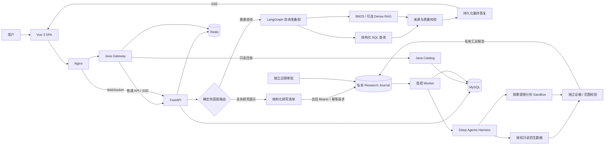
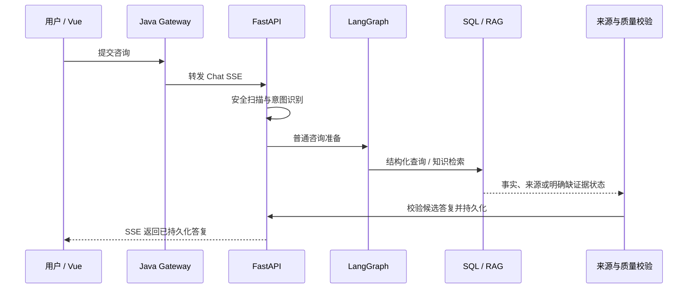
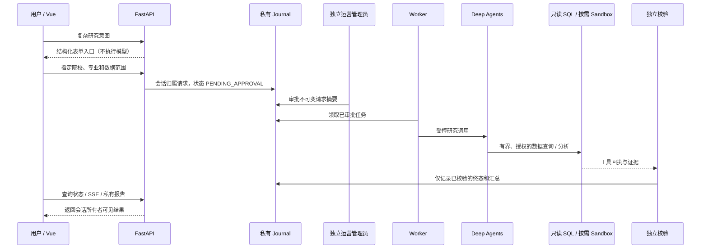

# Gaobao Advisor｜高考志愿智能顾问

[](https://github.com/Xander-Xai/Gaobao-Advisor/actions/workflows/ci.yml)
[](https://github.com/Xander-Xai/Gaobao-Advisor/actions/workflows/codeql.yml)
[](LICENSE)
[](pyproject.toml)
[](frontend/package.json)

Gaobao Advisor（高报）是一个面向中国高考志愿咨询场景的全栈开源示例：它把结构化招生数据、可追溯证据、受约束的咨询工作流与人工审批后的复杂研究连接起来。Agent 用于处理多轮上下文和受控研究任务；录取事实仍以经过来源登记和校验的数据为准。仓库随附的招生数据与知识语料均为合成演示内容，**不能用于真实志愿决策**。

## 你可以做什么

- 进行多轮志愿咨询，查询院校、专业、历史录取数据与招生计划。
- 在知识检索有依据时查看来源；缺证据、数据或检索资产异常时明确降级或拒答。
- 通过 Vue 数据浏览器查看演示数据，通过运营工作台管理质检任务和审核。
- 在显式启用的非生产环境中提交结构化复杂研究请求；请求属于会话所有者，进入独立审批与私有任务流程，完成后仅返回经过校验的汇总报告。
- 用合成基准、独立数据 Oracle 和集成测试检查执行边界，而不把合成结果当作真实模型质量或招生效果。

## 架构



普通咨询由现有确定性 LangGraph 工作流处理。命中复杂研究规则时，Chat 只执行安全扫描并显示结构化请求入口，不在该轮运行 SQL/RAG、模型或付费 Judge；提交请求仍不会启动模型。请求需独立运营人员审批，随后由既有 Worker 调用 Deep Agents，并在发布报告前执行独立验证。原生只读 Harness 与 Coding Sandbox 基准是回归/评测资产，不是第二个默认聊天引擎。

## 业务流程

**普通咨询**



**复杂研究**



当前研究 Chat 接入默认为关闭，且 production/industrial profile 不开放；标准演示环境也不会执行真实模型研究。该流程的合成 HTTP/审批/Worker/隔离测试见 [`tests/test_chat_research_runs.py`](tests/test_chat_research_runs.py)。

## 快速开始

### 1. 无模型密钥的本地全栈演示（推荐）

需要 Python 3.10 或 3.11、Docker Engine 与 Docker Compose v2.24+。该方式启动 Java Gateway/Catalog、FastAPI、Vue 静态前端、MySQL、Redis 与质检 Worker；使用合成数据，不需要 API Key。

```bash
git clone https://github.com/Xander-Xai/Gaobao-Advisor.git
cd Gaobao-Advisor
python -m pip install -e .
python scripts/setup_full_env.py
python scripts/compose_standard.py up --build -d
```

`setup_full_env.py` 会生成权限为 `0600` 的 `.env.full`，并只显示一次本地管理员密码；请自行保存，不要提交该文件。访问：

| 服务 | 地址 |
|---|---|
| Web 应用 | <http://localhost> |
| 数据浏览器 | <http://localhost/data> |
| 运营工作台 | <http://localhost/admin> |
| 健康状态 | <http://localhost/api/v1/health> |
| API 文档 | <http://localhost/docs> |

验证合成数据与 RAG：

```bash
curl -fsS http://localhost/api/v1/health
curl -fsS 'http://localhost/api/v1/data/overview'
curl -fsS -X POST http://localhost/api/v1/knowledge/search \
  -H 'Content-Type: application/json' \
  -d '{"query":"平行志愿的投档规则是什么"}'
```

健康状态应标记 `SYNTHETIC_DEMO`。无模型密钥时，普通咨询使用确定性模板并显式标记降级。

```bash
curl -N -X POST http://localhost/api/v1/chat \
  -H 'Content-Type: application/json' \
  -d '{"session_id":"demo-session-001","scene":"gaokao","message":"我是示例省·甲的物理类考生，600分，想了解计算机专业（合成演示）"}'
```

首次请求会忽略请求体里的会话 ID，返回服务端签发的 ID 和 Bearer token；该咨询输出只演示软件行为，不是志愿建议。复杂研究短语会被安全路由：默认环境明确拒绝启动研究；在获批、显式启用的非生产环境才显示结构化表单，仍需独立运营审批。停止服务并保留本地数据卷：

```bash
python scripts/compose_standard.py down
```

### 2. 可选真实模型开发模式

本地运行需要 Python 3.10/3.11、Node.js 20；以下示例使用 SQLite 合成库与普通咨询链路。配置的模型服务会产生外部请求和费用；只使用你有权使用的凭据，并设置提供商可用的预算/限额。

```bash
python -m venv .venv
source .venv/bin/activate
python -m pip install -e '.[dev]'
python -m scripts.seed_demo_data --db data/demo.db --reset
export DATABASE_URL=sqlite:///data/demo.db
export LLM_API_KEY='由你本地提供'
export LLM_BASE_URL='https://api.example.com/v1'
export LLM_MODEL='your-model-id'
uvicorn server.main:app --reload
```

前端另开终端运行 `cd frontend && npm ci && npm run dev`，默认地址 <http://localhost:3080>。删除或停止模型配置后即可回到无 Key 的确定性路径。`LLM_API_KEY` 不要写入 shell 历史、截图、日志或仓库。
停止 API 和前端开发服务器分别按 Ctrl+C。

### 3. 全栈与工业部署候选

标准全栈本地 Compose 命令见上方。使用授权真实招生数据的部署是**候选合同**，不是生产许可；须先满足数据来源、隐私、TLS、凭据、备份恢复、可用性与实际业务验收门禁。环境文件、外部 MySQL/Redis、独立迁移、manifest pin 和 Java Catalog 凭据要求见[`工业部署与发布门禁`](docs/architecture/industrial-release-contract.md)。在该文档列出的外部资源与授权均已准备后，运行：

```bash
docker compose --env-file .env.industrial -f docker-compose.industrial.yml config --quiet
docker compose --env-file .env.industrial -f docker-compose.industrial.yml up --build -d
curl -fsS http://127.0.0.1:8088/api/v1/health/ready
docker compose --env-file .env.industrial -f docker-compose.industrial.yml down
```

这些命令仅用于候选配置验证，不是本轮执行过的生产部署，也不构成开放公网许可。

### 4. 可复现研究 Demo 与限制

项目提供普通咨询 API 的无 Key 演示。复杂研究路径在默认配置下关闭；没有授权数据、独立审批配置及真实模型授权时，正确结果是请求不可用或停止执行，不会用合成院校伪造招生研究。可在无外部模型调用的前提下复现会话隔离、幂等、审批状态、Worker 回执和私有报告契约：

```bash
# 先按开发模式安装 `.[dev]` 测试依赖
python -m pytest tests/test_chat_research_runs.py -q --no-cov --override-ini addopts=''
```

该测试用隔离数据库和注入的确定性 Worker 回执覆盖从 Chat 请求、独立审批到校验报告及跨会话拒绝；它**不是**真实 Deep Agents 模型表现、真实招生数据质量或生产 UAT 证据。仓库没有伪造 UI 截图；现有合成演示界面图见 [`docs/images`](docs/images/)。

## 工程能力与验证边界

状态含义并不互相替代：`IMPLEMENTED` 是代码存在，`INTEGRATED` 是接入正式业务调用链，`VERIFIED` 是指定测试范围通过，`MERGED` 是在默认分支，`PRODUCTION_VALIDATED` 仅表示真实生产验收。未测指标标为 `NOT_MEASURED`。

| 能力 | 实现 / 集成 | 已验证范围 | 未验证边界 |
|---|---|---|---|
| 普通咨询与来源治理 | IMPLEMENTED / INTEGRATED / MERGED | 合成 SQL/RAG、证据与拒答回归 | 真实招生结论与用户效果 `NOT_MEASURED` |
| Chat 复杂研究入口 | IMPLEMENTED / INTEGRATED / MERGED | 会话归属、请求幂等、审批、Worker、私有报告的合成 HTTP 测试 | 真实数据/模型/生产 UAT 尚未完成 |
| Deep Agents Harness | IMPLEMENTED / INTEGRATED | 显式授权研究 Worker、受限工具和报告校验；SDK 无外呼构建检查 | 真实模型成功率/费用/延迟 `NOT_MEASURED` |
| Context / Session Snapshot | IMPLEMENTED / INTEGRATED | 标准本地合成全栈快照与隐私负例 | 用户真实记忆收益、生产隐私验收未完成 |
| Skills 与长期偏好记忆 | IMPLEMENTED；记忆为 opt-in 实验 | 合成与隔离测试 | 真实用户偏好安全与效果未测 |
| Sandbox | IMPLEMENTED / INTEGRATED（研究分析范围） | CI Docker 安全负例与合成描述性分析 | 多租户生产隔离未验证 |
| Agent Eval / 优化门禁 | IMPLEMENTED；合成 Eval 已集成 CI | 确定性/脚本化 Oracle、预算和回执完整性 | 真实模型配对实验、独立人工 Gold 未完成 |
| Java / FastAPI / Vue 全栈 | IMPLEMENTED / INTEGRATED / MERGED | 主线 CI 含 Python、Vue、MySQL、Redis、Compose smoke | 真实业务部署、容量/SLO 未验证 |

唯一动态状态入口为 [`docs/PROJECT_STATUS.md`](docs/PROJECT_STATUS.md)，其中记录当前边界、证据链接及实时 GitHub 查询方式。当前分支、Issue、PR、CI、Release 等可能变化的信息请以 GitHub 为准。

## 技术栈

| 职责 | 实际使用 |
|---|---|
| 前端 | Vue 3、Vite、Pinia、Vue Router、TypeScript（运营界面） |
| API 与业务编排 | FastAPI、Pydantic、SSE；LangGraph 确定性咨询图 |
| 复杂研究 Harness | 可选 Deep Agents SDK，由独立、审批后 Worker 调用 |
| Context 与 Skills | 受限会话上下文/加密快照；显式 Skills；可选、默认关闭的独立偏好记忆 |
| 数据与检索 | MySQL 8.4、SQLAlchemy、Alembic、Redis、BM25；可选 Dense embedding |
| Sandbox | Docker 隔离分析执行，固定输入与独立结果校验；不是通用 Shell Agent |
| Eval | Python 合成业务集、独立 SQL/证据 Oracle、配对评测输入契约 |
| 基础设施与观测 | Java 21/Spring Gateway 与只读 Catalog、Docker Compose、Nginx、Prometheus、可选 Sentry |
| 质量与安全 | pytest、Vitest、Ruff、CodeQL、gitleaks、pip-audit、npm audit |

## 文档导航

- [快速上手、文档地图与主要入口](docs/README.md)
- [当前项目状态与验收缺口](docs/PROJECT_STATUS.md)
- [系统架构、路由与模块职责](docs/architecture/README.md)
- [私有复杂研究 TaskRun](docs/admissions-research-taskrun.md) · [Chat 请求与报告](docs/admissions-research-private-report-20261125.md)
- [开发与贡献](CONTRIBUTING.md) · [测试 / Eval 手册](benchmarks/README.md)
- [数据库结构](docs/database-schema-matrix.md) · [API/OpenAPI](http://localhost/docs)
- [本地部署与工业候选门禁](docs/architecture/industrial-release-contract.md) · [Java 服务](docs/java-microservices.md)
- [安全政策](SECURITY.md) · [隐私边界](PRIVACY.md) · [数据许可](DATA_LICENSE.md)
- [版本变更](CHANGELOG.md) · [架构决策记录](docs/superpowers/adr/)

## 版本、许可与归属

应用版本由 [`server/__init__.py`](server/__init__.py) 定义（当前 `3.0.0`）；前端包版本 `0.0.0` 是私有构建配置，不代表发布版本。当前没有正式 GitHub Release；仓库存在一个归档用途的非语义化 Tag，不作为产品版本。代码采用 [MIT License](LICENSE)；演示数据与合成语料的授权见 [DATA_LICENSE.md](DATA_LICENSE.md)，第三方及上游代码归属见 [THIRD_PARTY_NOTICES.md](THIRD_PARTY_NOTICES.md)。MIT 代码许可不授予再分发使用者导入的第三方招生数据或语料的权利。
