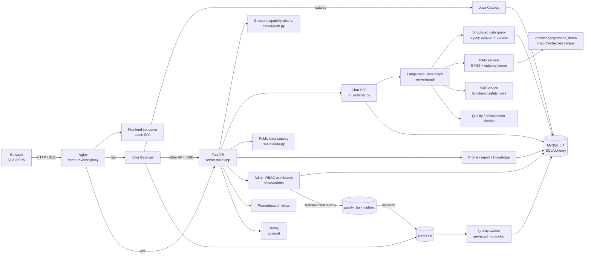
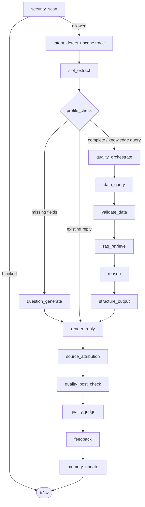
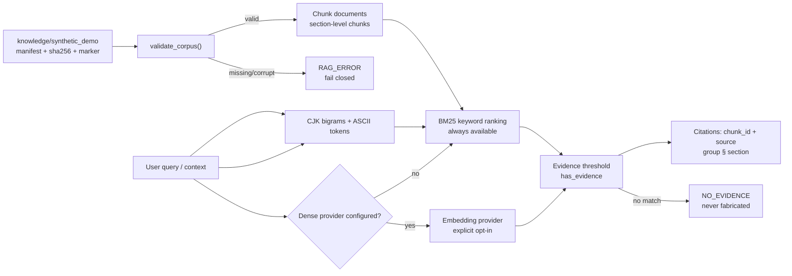
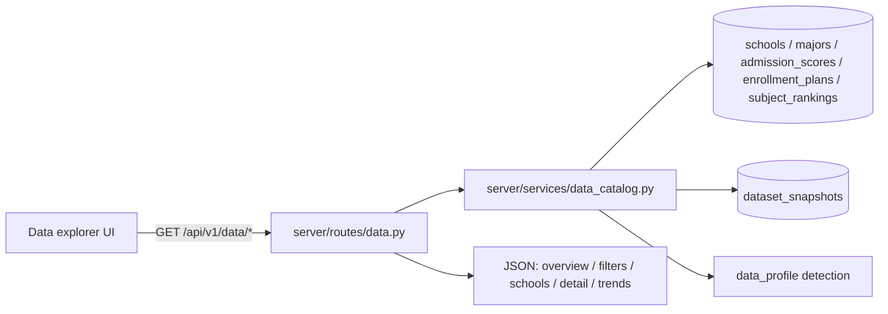
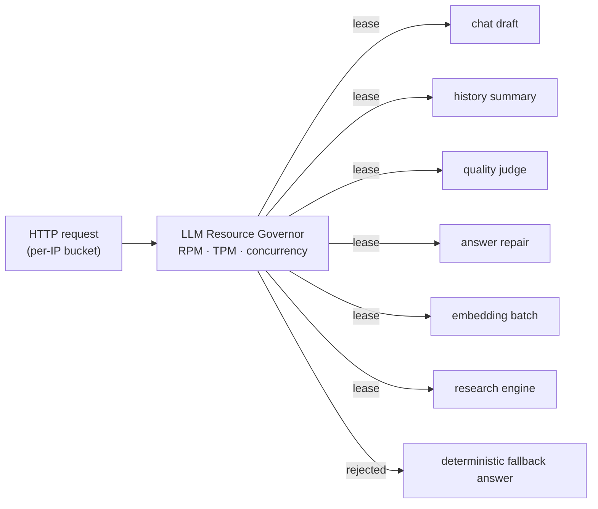
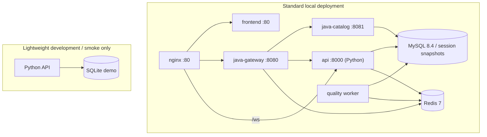

# Architecture

**当前状态入口**：实现与验收状态统一维护在 [`docs/PROJECT_STATUS.md`](../PROJECT_STATUS.md)。本架构文档描述仓库代码路径；历史 SHA、CI 快照及候选部署边界不得当作实时状态或生产许可。工业招生证据治理及其 PR 历史见[工业招生证据文档](industrial-admissions-evidence.md)。

This document is the authoritative architecture reference for
`gaobao-advisor`. It describes the code that ships in this repository, not a
future design. The ADRs under [`docs/superpowers/adr/`](../superpowers/adr/)
record why the larger decisions were made.

## Architecture decision freeze — 2026-11-25

**主架构：确定性在线咨询 + 独立受控复杂招生研究 Harness。** 本仓负责 Harness/Eval/Context、受限执行和全栈业务交付；上游 MIT 代码归属见 `THIRD_PARTY_NOTICES.md`，公开维护增量以当前源码和对应验证记录为准。

| 设计 | 裁决 | 边界 / 验收 |
|---|---|---|
| Online chat | 保留 LangGraph 确定性图 | 单次事实查询不经自主 Loop；SQL/来源和选科、年份、省份、位次硬约束优先；模型解释不替代事实 |
| 图节点 | 按责任裁剪 | 节点数不是自主调用次数；相邻纯规则节点只有在独立路由、观察或恢复有价值时保留；改动须保持 API/SSE、拒答和状态契约 |
| Native readonly Harness | 保留为最小参考和可控评测基线 | 不成为第二套默认聊天引擎；不重复扩展通用生产运行时 |
| Deep Agents | 唯一复杂招生研究执行引擎 | 已有 operator research runner；独立的确定性 SQL subgraph 不是自主模型专家；批准范围、工具预算、SQL 回执和结果验证优先；受控研究 API 与 worker 共用独立私有 journal；已合并的 #192/#193/#194/#196 提供业务路径；真实模型、真实数据和生产验收仍独立 |
| Sandbox | 仅招生分析有业务主责 | 算术代码修复是隔离回归 fixture，不是用户功能；只准批准数据快照、受限容器、独立 Oracle 校验；无 Docker socket/任意 host shell 暴露给模型 |
| Memory / Context | 保留分层；标准本地合成部署默认启用语义压缩和持久快照 | SQL 事实/当前任务不截断；摘要是非可信上下文；长期偏好独立且可撤回，不能替代录取依据 |
| MySQL / Redis / Java | 标准部署正式组件 | MySQL 为业务事实、会话与快照存储；Redis 为限流和质检队列；Java Gateway/Catalog 为入口和只读目录；Python 为唯一 Agent 入口；SQLite 仅轻量开发及独立受控 journal |
| Eval | 独立业务真值优先 | 合成 Oracle 与真实模型、真实招生效果分开；A/B 只允许一个明确变量，不自动发布模型修改 |

**目标边界（非已上线）**：简单咨询 → 确定性业务图；复杂研究 → 经批准的 Deep Agents 执行 → 只读 SQL/分析沙箱 → 独立证据核验 → 报告。Deep Agents 的 InMemorySaver 不等于持久图恢复；受控研究 journal 持久化任务生命周期、身份/审批和执行回执，过期任务不自动重放，不建立平行生产队列。原生 Harness、合成实验、旧 benchmark 保留用于对照或回归，不为每条路径重复增设功能。

**Chat 请求接入（ADR-010）**：`POST /api/v1/chat` 用窄范围、确定性的短语规则识别部分明确的多院校/多约束请求；命中后保留安全扫描、绕过咨询图与 SQL/RAG 查询，并跳过自由文本模型生成和付费 Judge 调用，改为结构化研究入口提示。Chat 页面提供显式研究表单，`POST /api/v1/chat/research-runs` 以当前 session capability 建立同一私有 TaskRun。检测不抽取院校/专业范围、不自动创建 TaskRun、不授权付费调用；简单事实查询仍走确定性业务图。严格需要独立运营审批和现有 Worker。请求功能默认关闭，production/industrial profile 不开放。SSE 是 TaskRun journal 状态的流式投影，不表示未记录的百分比或模型内部步骤。生产及真实数据验收仍未完成。

**架构裁剪门禁**：先确认默认路由、operator 入口、实验入口的调用关系和兼容合同；再做等价状态/失败回归和简单基线对比。没有证据不删除安全检查，不自动开启模型、沙箱、真实数据或付费调用。未完成架构裁剪前暂停新增技术栈和能力缺口扩展。

### Entry-point and state ownership decision (#190)

The integrated research lifecycle entered master in #192/#193/#194; #196 subsequently strengthens delegation binding and independently classified no-history rejection. The following describes the checked-out source, not a production claim.

| Entry point | Actual responsibility | Architecture decision |
|---|---|---|
| `server/routes/chat.py` → `get_chat_preparation_graph()` | 12 registered preparation nodes ending at render_reply; SSE route owns candidate checks and persistence | Keep one public consultation path. Do not run the 17-node finalized variant and then finalize again. |
| `server/graph/graph.py::get_advisor_graph` | Full 17-node graph with finalizers | Retain compatibility/reference; never count 17 nodes as 17 online model calls. |
| `server/agent/readonly_harness.py` / `native_taskrun_harness.py` | Bounded loop reference and synthetic evaluation | Not another public chat engine or production research runtime. |
| `server/routes/agent_taskruns.py` / `taskrun_store.py` | Synthetic operator journal | Keep physically isolated from private admissions and real research data; its receipts cannot authorize private work. |
| `server/agent/admissions_deepagents.py` | Shared Deep Agents research engine with InMemorySaver | Sole complex-research engine; standalone CLI is disabled when managed research is enabled. Process restart is not graph-resume support. |
| `server/agent/admissions_analysis_sandbox.py` / `sandbox_runtime.py` | Restricted admissions analysis / synthetic security fixtures | Use deterministic SQL/functions first; no arbitrary shell from public chat. |
| `server/routes/admissions_research_runs.py` → `admissions_research_taskrun.py` | Operator-only API, private SQLite journal, exact-spec approval and CAS state transitions | Single managed research lifecycle; no HTTP model execution. |
| `server/routes/chat_research_runs.py` | Explicit session-owned request/status/cancel/report surface backed by the same journal | Non-production opt-in; creates PENDING_APPROVAL and never starts a model. |
| `server/agent/admissions_research_dispatch.py` | Bounded operator dispatch of approved runs | Calls the same execution slot and journal claim; not a separate queue. |

A physically separate synthetic journal is a trust boundary, not a second production engine. The private research path must have exactly one authoritative owner/approval/lease/receipt/state transition contract. Do not expose a second queue, allow synthetic approvals to authorize real work, or interpret a persisted job row as a persisted graph checkpoint. If recovery of a paid or externally uncertain action is not proven, park the run for reconciliation rather than replaying it.

Managed execution flow: operator submission → immutable spec digest → independent admin approval → exclusive local worker slot → journal claim → shared Deep Agents engine → SQL/sandbox evidence verification → guarded terminal result. Cancellation or lease expiry prohibits later publication; in-flight provider work may still finish. Expired paid runs are not automatically replayed. Synthetic TaskRun storage is separate by transactional schema checks. This is single-host local task durability, not distributed graph checkpoint resume, production multi-tenancy, or measured provider success. See [private research taskrun](../admissions-research-taskrun.md) and [dispatch](../admissions-research-dispatch.md).

Retain existing graph nodes until a behavior-preserving comparison justifies removal. Security scan, profile branching, data validation, source attribution, candidate gate and final persistence are distinct responsibilities; simple sequential edges alone are not evidence that a node is redundant. Any consolidation must preserve the SSE event/refusal contract, hard admissions constraints and single ownership of final persistence.

Acceptance: exact-head CI, API and SSE contracts, deterministic negative cases and one research lifecycle authority; no real model/data calls are implied by this decision. Architecture convergence Issue #190 is closed; real-model, authorized-data and production acceptance remain separately tracked in [PROJECT_STATUS.md](../PROJECT_STATUS.md).

## 1. System overview

`gaobao-advisor` is a read/write web application with five runtime roles:

1. **Vue 3 SPA** — chat, structured recommendation cards, public data explorer,
   profile/report views, and the administrator workbench.
2. **FastAPI application** — HTTP/SSE/WebSocket transport, session capability
   tokens, request correlation, rate limiting, and API error envelopes.
3. **LangGraph advisor graph** — deterministic orchestration of security scan,
   intent/scene routing, slot extraction, profile checks, structured data
   queries, RAG retrieval, reasoning, structured output, source attribution and
   quality checks.
4. **Quality worker** — consumes data-quality jobs from Redis and writes
   findings to the database.

5. **Java Gateway and Catalog** — standard ingress routing and read-only catalog queries.

The #198 standard-local deployment candidate (`python scripts/compose_standard.py up --build -d`; verify merge before attributing to master) requires MySQL 8.4, Redis 7, Java Gateway/Catalog and the worker, with no LLM key required. The SQLite base remains a lightweight smoke/development compatibility path; private research journals remain isolated SQLite. Session compaction and AES-GCM SQL snapshots default on in the standard local synthetic stack; the API fails startup without a valid configured key, the worker prunes expired snapshots, and explicit false rolls back. Production snapshots remain blocked pending privacy approval.

> **Standard Java gateway/catalog (original implementation merged in #89, squash `7c87686`):** PR [#89](https://github.com/Xander-Xai/gaobao-advisor/pull/89)
> introduced Java 21 / Spring Boot 4.0.9 / Spring Cloud 2025.1.4 as a layer now required by the standard architecture: Nginx keeps `/ws/**` on Python, sends
> `/api/v1/catalog/**` to a Java Gateway + read-only MySQL Catalog
> (Redis Lua fail-closed global throttling, HTTP 429 on exhaustion, 503 on Redis
> outage), and leaves all other `/api/**` — chat SSE, auth, graph, admin — on the
> existing Python FastAPI. The overlay removes Python API/frontend host ports.
> Demo/Compose fault-injection acceptance passed on synthetic data only;
> public production remains NO-GO (no TLS, no real-data authorization, no
> cross-host HA, no capacity/SLA). See [Java microservices](../java-microservices.md).



### Layer responsibilities

| Layer | Path | Responsibility |
|---|---|---|
| API / transport | `server/main.py`, `server/routes/`, `server/admin/routes.py` | Routing, validation, auth entry points, response/error shape, SSE framing |
| Application | `server/graph/`, `server/services/`, `server/admin/service.py` | Use cases, graph orchestration, query composition, transaction boundaries |
| Domain | `server/domain/`, `slots/`, `quality/` | Slot/profile rules, structured recommendation contract, quality rules |
| Infrastructure | `db/`, `legacy/`, `server/services/llm_router.py`, `server/services/kb_retriever.py`, `server/admin/queue.py` | Persistence, model providers, retrieval, queue, external adapters |

The codebase is being migrated incrementally to this shape. New read models
(for example the public data catalog) live behind a service; older modules
(`legacy/gaokao_data.py`, `db/crud.py`) remain as adapters for compatibility.

## 2. Online Q&A flow

```mermaid
sequenceDiagram
    autonumber
    participant U as User
    participant SPA as Vue SPA
    participant API as FastAPI /chat
    participant DB as Database
    participant G as LangGraph
    participant RAG as Knowledge corpus
    participant LLM as LLM provider (optional)

    U->>SPA: Enter profile / question
    SPA->>API: POST /api/v1/chat (SSE)
    API->>API: First anonymous turn: issue server-owned session_id
    API->>DB: Load persisted slots and query state
    API->>G: invoke(initial_state) in a worker thread
    G->>G: security_scan
    Note over G,API: Blocked input ends immediately with a deterministic refusal; no model or memory write
    G->>G: allowed: intent_detect (includes scene trace) -> slot_extract
    G->>G: profile_check
    alt Profile incomplete
        G-->>API: question_generate -> render_reply
    else Profile complete or knowledge query
        G->>G: quality_orchestrate
        G->>DB: data_query (rank/score/plan lookup)
    G->>G: validate_data (per-school provenance, no cross-school comparison)
        G->>RAG: rag_retrieve (BM25, optional dense)
        RAG-->>G: chunks + citations or explicit NO_EVIDENCE/error
        G->>G: reason -> structure_output -> render_reply
    end
    Note over G,API: Public SSE invokes preparation-only graph, stopping at render_reply
    alt LLM key configured and a model path is selected
        API->>LLM: async model request (buffer draft)
        LLM-->>API: unpublished candidate chunks
    else No key / no policy evidence
        API->>API: deterministic template / explicit safe refusal
    end
    API->>API: source_attribution -> quality_post_check -> quality_judge
    API->>DB: persist final user+assistant+slots in one transaction
    API-->>SPA: slots / structured / sources + validated answer SSE events
    API-->>SPA: done {session_id, session_token}
    SPA->>API: Later turns with Bearer token
```

Important invariants:

* An anonymous first request always gets a **server-generated** session ID. A
  caller-supplied ID cannot mint a token (regression test:
  `tests/test_public_demo_acceptance.py::TestSessionIdentity`).
* The database is the source of truth for a persisted profile; stale client
  slots only fill unknown keys.
* The public chat path uses `build_advisor_graph(finalize=False)` for preparation;
  the full graph remains available to offline callers. The SSE route buffers
  model output, then validates and atomically stores the final answer before
  publishing chunks. These SSE chunks are **not** raw provider token latency.
  The template reply is the offline/error/quality-gate fallback.
* RAG failures are explicit (`RAG_ERROR` / `NO_EVIDENCE` / `RAG_DISABLED`), not
  silently converted into an answer without evidence.

## 3. LangGraph state flow

The compiled graph is defined in `server/graph/graph.py`; the state contract is
`server/graph/state.py`.



The full offline graph registers 17 application nodes; the public preparation graph registers 12. The scene_route function is a trace-only helper inside intent_detect, not a separate graph step; its trace event is retained. A security refusal ends both graphs at security_scan and the SSE handler emits only refusal text and done, without model calls or conversation/slot persistence. Other finalization behavior is unchanged.

The diagram above represents the full offline graph. The public chat route uses
the preparation-only variant ending at `render_reply`, then runs the same
finalizers against the **actual candidate answer**, not the template.

State channels include slots/profile snapshot, RAG chunks/evidence/sources, data
query results, per-school provenance validation, structured result, reply/reply
source, quality scores, retrieval state and the persisted `_query_state` used
by the follow-up question engine. LLM-as-Judge scores remain diagnostic rather
than independently verified proof of factual correctness.

## 4. RAG retrieval chain

`server/services/rag.py` owns corpus lifecycle; the retrieval engine is
`server/services/kb_retriever.py`.



The shipped corpus is original synthetic material. A corpus without the
`SYNTHETIC_DEMO` marker, a bad hash, a missing file, or a symlink is rejected.
Network embedding providers are only used when explicitly configured; an LLM
key alone does not enable them.

## 5. Data processing and public data catalog

### Demo data

`scripts/seed_demo_data.py` is a pure, deterministic generator (fixed seed
`20240617`). It creates:

* 8 fictional schools, 12 fictional majors;
* three synthetic admission years (the most recent three complete years);
* admission scores, enrollment plans and subject rankings;
* a `dataset_snapshots` row with version, profile, generation time and year
  range.

Every school carries `special_type = SYNTHETIC_DEMO_DATA` and `（合成）` in its
name. The seed is idempotent for a non-empty database; `--reset` recreates a
SQLite demo.

### Public read model



The public catalog never touches administrator review, audit, revocation or
quality-job tables. It exposes aggregates, bounded school detail and trends.
Trends are grouped by subject type and never mix provinces, exam modes or
subject types into one line. `GET /api/v1/data/schools` keeps the original
cursor-based contract; `q`, `province`, `level`, `school_type` and `total` are
additive.

### Database schema ownership

* SQLite demo: `db.database.init_db()` uses `Base.metadata.create_all`.
* MySQL: Alembic migrations in `migrations/versions/`; the container entrypoint
  runs `python -m db.migrate` before starting the API.
* `db/schema_contract.py` derives table/column/index/FK expectations from the
  ORM and is used by MySQL adoption/migration tests.

## 6. Redis / worker task flow

The queue is deliberately small: one queue, one job type, job IDs only.

```mermaid
sequenceDiagram
    autonumber
    participant Admin as Admin workbench
    participant API as FastAPI admin routes
    participant DB as Database
    participant Outbox as quality_task_outbox
    participant Redis as Redis list
    participant Worker as Quality worker

    Admin->>API: POST /api/v1/admin/quality/jobs
    API->>DB: create job (PENDING)
    API->>Outbox: insert outbox row (same transaction)
    API->>DB: commit
    API->>Redis: best-effort dispatch
    alt Redis unavailable in async mode
        API-->>Admin: 202 PENDING + warning (not success)
    else dispatched
        API-->>Admin: 202/200 job id
    end
    Worker->>Redis: BRPOP job id
    Worker->>DB: atomic claim PENDING -> RUNNING with attempts fencing
    Worker->>DB: collect deterministic issues, complete job
    Worker->>DB: audit event + issue rows
    Worker->>Redis: next job
    Note over Worker,DB: Startup/periodic scan recovers stale RUNNING and orphaned DISPATCHED jobs. Delivery is at-least-once; the unique issue constraint and claim fencing absorb duplicates.
```

`KEEP_LIST` is the documented delivery decision (ADR-009). The database, not
Redis, is the state source of truth. Recovery is lease-based (60s delivery /
600s execution by default), not an exactly-once guarantee.

### Model resource governance

Redis carries a second, independent budget: the provider quota of the
internal model calls. The public per-IP limiter bounds how many *requests* a
client may send; it cannot bound how many *model* calls one accepted request
produces (summary, draft, judge per dimension, repair, embedding, retry,
provider fallback). The LLM Resource Governor owns that budget:



Every admission is one atomic Redis Lua script, so several API and Worker
instances share one budget. Concurrency is a lease semaphore with expiry
reclamation, not a token bucket: a crashed worker cannot hold a slot forever.
A retry and a provider fallback are new admissions, so neither bypasses the
budget. The full design, the configuration reference and the model call
coverage matrix are in
[LLM Resource Governance](llm-resource-governance.md).

## 7. Deployment topology



MySQL and Redis are not published to the host in the standard deployment; services use
the Compose network. Production TLS configuration is separate from the HTTP-only
demo proxy.

In the standard deployment Nginx exposes only port 80 on the host: the Compose
`!reset []` directive removes the Python API `8000` and frontend `3080`
host mappings so the gateway cannot be bypassed.

## 8. Source map

| Concern | Authoritative path |
|---|---|
| API entry point / middleware | `server/main.py`, `server/middleware/` |
| Chat SSE and session issuance | `server/routes/chat.py`, `server/auth.py` |
| LangGraph graph/state/nodes | `server/graph/graph.py`, `state.py`, `nodes/` |
| Slot extraction and persistence | `slots/`, `server/graph/nodes/extract.py`, `memory.py` |
| Structured recommendation | `server/graph/nodes/structure.py`, `server/domain/schemas.py`, `frontend/src/components/chat/StructuredCard.vue` |
| RAG corpus and retrieval | `server/services/rag.py`, `kb_retriever.py`, `knowledge/synthetic_demo/` |
| Public data catalog | `server/routes/data.py`, `server/services/data_catalog.py`, `server/domain/data_catalog.py` |
| Admin RBAC / quality / audit | `server/admin/` |
| Queue and worker | `server/admin/queue.py`, `server/admin/worker.py` |
| Model resource governance | `server/services/llm_governor.py`, `server/services/llm_gateway.py`, `server/agent/governed_chat_model.py`, `config/llm_governance.yaml` |
| Persistence / migrations | `db/`, `migrations/versions/` |
| Demo dataset generator | `scripts/seed_demo_data.py` |
| Data explorer UI | `frontend/src/views/DataView.vue`, `components/data/` |
| Tests / CI | `tests/`, `frontend/src/**/__tests__/`, `.github/workflows/` |
| Java gateway / catalog | `java-services/gateway/`, `java-services/catalog/`, `deploy/java/nginx.conf` |
| Distributed load benchmarks | `benchmarks/load/`, `benchmarks/overview_perf_bench.py` |

## 9. Public API surface

| Method | Path | Purpose | Auth |
|---|---|---|---|
| GET | `/api/v1/health` | Liveness + DB/RAG state + data profile | Public |
| GET | `/api/v1/health/live` | Process liveness | Public |
| GET | `/api/v1/health/ready` | DB readiness (503 when down) | Public |
| POST | `/api/v1/chat` | SSE chat turn | Anonymous first turn; Bearer for continuation |
| GET | `/api/v1/data/overview` | Data coverage/provenance | Public |
| GET | `/api/v1/data/filters` | Filter values in the database | Public |
| GET | `/api/v1/data/schools` | School search + cursor pagination | Public |
| GET | `/api/v1/data/schools/{id}` | School detail + bounded samples | Public |
| GET | `/api/v1/data/scores` | Score rows | Public |
| GET | `/api/v1/data/plans` | Enrollment plans | Public |
| GET | `/api/v1/data/trends` | Subject-separated score trend | Public |
| POST | `/api/v1/knowledge/search` | RAG evidence search | Public |
| GET/PUT | `/api/v1/profile/{session_id}` | Persisted profile | Session Bearer |
| POST | `/api/v1/report/generate` | Report generation | Session Bearer |
| `/api/v1/admin/*` | — | RBAC operations workbench | Admin Bearer |

The full generated schema is available at `/docs` when the API is running.

In the standard deployment, the gateway serves
`GET /api/v1/catalog/schools` and `GET /api/v1/catalog/schools/{id}` (read-only
MySQL catalog, Redis-rate-limited). Every other path is still served by the
Python application.

## 10. Key decisions and ADR index

| ADR | Decision |
|---|---|
| [ADR-001](../superpowers/adr/ADR-001-fastapi-migration.md) | FastAPI transport |
| [ADR-002](../superpowers/adr/ADR-002-langgraph-flow.md) | LangGraph state machine; no extra agent layer |
| [ADR-003](../superpowers/adr/ADR-003-sqlite-wal-joinedload.md) | SQLite WAL and eager loading |
| [ADR-004](../superpowers/adr/ADR-004-hybrid-rag.md) | BM25-first hybrid retrieval, fail-closed corpus |
| [ADR-005](../superpowers/adr/ADR-005-voice-integration.md) | Optional voice integration |
| [ADR-006](../superpowers/adr/ADR-006-adr-process.md) | ADR process |
| [ADR-007](../superpowers/adr/ADR-007-admin-workbench-rbac.md) | Admin workbench RBAC and audit |
| [ADR-008](../superpowers/adr/ADR-008-mysql-redis-worker.md) | Optional MySQL/Redis/worker profile |
| [ADR-009](../superpowers/adr/ADR-009-redis-delivery-selection.md) | Keep Redis List + Outbox as delivery mechanism |
| [ADR-010](../superpowers/adr/ADR-010-chat-submitted-admissions-research.md) | Chat may submit an explicit scope to the existing operator-approved research lifecycle |

## 11. Boundaries

* The demo is not a production admissions decision system; synthetic data must
  not be used for real applications.
* The graph is intentionally a single state machine. Adding agents requires a
  demonstrated need, not a diagram preference.
* Multi-worker deployments need an explicit `SESSION_SECRET`; anonymous
  sessions are capability tokens, not an account system.
* Public data endpoints are rate-limited by the application middleware, but the
  demo does not claim a production-grade anti-abuse or SLA posture.
* The Java overlay was accepted on Compose-level fault-injection evidence with
  synthetic data only. TLS, real-data authorization, dedicated credentials,
  cross-host HA and capacity/SLO remain open, so merging it is not approval to
  serve production traffic.


## Industrial release contract

The separate `docker-compose.industrial.yml` is the public SQL product release candidate, not the legacy credential smoke Compose. It requires externally managed MySQL and Redis, independently migrated schema, approved non-synthetic data, Java Gateway/Catalog, Python API and worker; it binds ingress to loopback behind external TLS. Startup rejects synthetic seeding, SQLite fallback, synthetic RAG, disabled required dependencies and unapproved experimental features. Redis failure makes readiness fail closed. Managed paid research remains an isolated approved operator service; no automatic paid dispatch is added to the public stack. See [release contract and acceptance matrix](industrial-release-contract.md). This design is not production verified.
