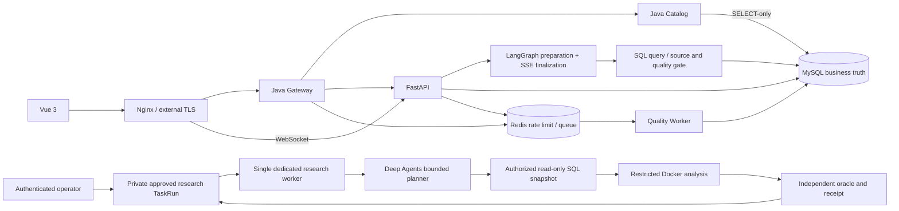

# 高报 Agent：工业架构与发布合同

**适用范围**：当前 checkout 的正式架构、工程部署候选和验收门禁。2026-11-25 核查 master 已合并 #198，基线 `2c27d0208095ae8616b6a1e18fc93d47282169ba`。本分支增量见 [工业招生证据治理](industrial-admissions-evidence.md)。本文不是上线许可。

## 1. 唯一职责与状态归属



| 层 | 正式职责 | 排除 |
|---|---|---|
| Vue / Java Gateway / Catalog | 入口路由、目录查询、Redis 全局限流 | Java 不重复实现 Agent；Catalog 使用独立 SELECT-only 凭据 |
| Python/FastAPI + LangGraph | 唯一在线咨询入口，12 节点准备图，SSE 校验及唯一持久化 | 17 节点图为兼容参考；不把节点数当模型步骤 |
| MySQL / Redis / Quality Worker | 业务、对话、事务 Outbox、质检任务；Redis 传递与限流 | Redis 不是业务真相；SQLite 不是标准业务 DB |
| Context / Session Snapshot | 近期原文、受限摘要、版本/前缀/TTL/CAS；标准本地 AES-GCM 加密和有界清理 | 摘要、偏好不是招生事实；原始对话加密及备份治理尚未完成 |
| Approved research | 私有 journal、异人审批、独立 worker、Deep Agents、受限沙箱、SQL 独立核验和私有报告 | 不开放匿名代码执行、不自动付费重试；单主机 journal 非分布式图恢复 |
| Eval | 独立 gold、业务事实 Oracle、回执与开发/Holdout | 合成测试和真实模型结果分开；不自动发布优化 |
| Regression | 原生只读 Harness、合成 decision-card、Coding fixture、负向规则记忆 | 非正式用户入口；保留作回归而非强行生产化 |

## 2. 标准本地与真实数据部署候选

标准本地合成环境：

```bash
python scripts/setup_full_env.py
# Existing env: python scripts/setup_full_env.py --add-java-reader
python scripts/compose_standard.py up --build -d
```

标准本地默认开启上下文压缩及加密 SQL 快照，生成的私有 .env.full 不得提交；配置真实模型会产生调用费用，不随 CI 自动运行。轻量 SQLite 仅供 smoke/兼容，不是正式全栈路径。

工业候选配置为 `docker-compose.industrial.yml`，与早期 `docker-compose.prod.yml`（历史凭据注入验证）区分。采用预先授权、已独立迁移的外部 MySQL 与 Redis；Java Catalog 由 DBA 授权独立只读账号；Nginx 仅绑定 loopback，必须经实际 TLS 入口、可信代理和访问控制验收后开放。当前仅 SQL 数据路径；现有仓库的 RAG 语料为合成数据，生产候选禁用，真实政策库须另行完成许可、版本、适用范围及检索验收。不得用合成语料冒充真实政策。

在私有 `.env.industrial` 中提供（禁止提交，权限 0600）：

- DATABASE_URL：已授权 MySQL 应用账号，不使用 root 或迁移账号。
- REDIS_URL：已配置认证与网络隔离的 Redis。
- GAOBAO_DATA_APPROVAL_REF：内部授权标识，不等于独立核验许可证。
- GAOBAO_ADMISSIONS_YEAR：候选配置必须明确审批历史年度；API/worker 检查该年度位次及院校级录取记录存在。
- CATALOG_JDBC_URL、CATALOG_DB_USER、CATALOG_DB_PASSWORD：同一数据集的独立只读账号。
- INDUSTRIAL_HTTP_PORT：可选本地反代端口，默认 8088。

单独的私有 `.env.industrial-api` 仅提供 SESSION_SECRET、管理员身份及 token secret、批准的 CORS 和模型配置；不要存放 Catalog root 或不相关服务凭据。镜像构建上下文排除 .env 和 .env.* 文件；应轮换可能曾进入旧镜像的任何凭据并审计旧镜像，而不是认为修改 ignore 即已删除旧层。

先使用独立 DBA 账号运行 `python -m db.migrate upgrade`，检查唯一 head、备份和可恢复性；再以应用运行账号启动。数据库必须为 CUSTOM（非空、无合成学校标记），这只是数据形态门禁，不证明数据权利或质量。应用 API/worker 跳过旧 demo entrypoint，不自动建表、迁移或 seed。两者独立执行同一工业配置、唯一 schema head、CUSTOM 数据及 Redis 启动门禁，不能仅依赖 Compose 的 API 启动顺序；失败时 worker 不消费队列（包括 --once）。此门禁是启动时检查，不证明运行中依赖始终健康。

```bash
docker compose --env-file .env.industrial -f docker-compose.industrial.yml config --quiet
docker compose --env-file .env.industrial -f docker-compose.industrial.yml up --build -d
curl -f http://127.0.0.1:8088/api/v1/health/ready
```

上述命令是部署候选操作，不是本次已执行的真实环境验证。不得打印 resolved config（可能含密钥）。未验证 TLS/认证/真实数据前不要对公网开放。

## 3. Release gates (NO-GO until measured)

| Gate | Implemented guard / required evidence | 当前状态 |
|---|---|---|
| G0 入口 | 一套标准 Java/MySQL/Redis/Python 拓扑，目录/聊天/运营质检 E2E，禁止 API 直通 | 新变更待 exact-head CI；历史 Java synthetic CI 不能替代 |
| G1 数据/Schema | MySQL explicit、独立迁移、唯一 Alembic head、CUSTOM 数据、授权与版本审计 | 启动门禁已实现；真实数据权利/质量仍需审核 |
| G2 隐私 | 摘要 AES-GCM、TTL 清理、无缓存研究 API、密钥隔离；原对话及备份删除、真实身份与同意 | 新加密实现待 CI；真实个人数据/长期偏好/生产摘要 NO-GO |
| G3 可靠性 | API 与 worker 独立启动校验、Redis readiness、外部 MySQL/Redis 断连、Outbox 恢复、备份恢复 | Catalog 的 Redis 限流不等于全部公共 API 跨副本限流；FastAPI 公共限流仍为进程内。实际候选集群故障注入、SLO 和恢复报告缺失 |
| G4 研究 | 授权数据、审批、身份/回执绑定、隔离、预算、正确拒答、独立 gold | #196 已合并；真实模型/真实数据/独立 gold/容器与 worker 部署验收未完成 |
| G5 Eval/优化 | 同模型、同 gold、同预算、完整分母和 Holdout；真实 usage/账单 | 无真实结果，不宣传降本 |
| G6 安全发布 | TLS、专用凭据、镜像/SBOM、轮换、监控告警、容量与回滚 | 无真实生产证据，NO-GO |

**不把所有实验移入生产。** 原生 Harness 与脚本化合成用例是正常工业回归资产；业务能力由明确入口、权限、状态、失败处理和独立验收承担。真实研究部署使用现有 `server.agent.admissions_research_dispatch`，在单独授权 worker host 和私有 journal 下运行，不在公开候选 stack 自动启动付费调用。需要扩展到分布式时，先设计 MySQL/队列 fencing 和外部调用不确定性，不伪称 exactly-once 或跨进程 Deep Agents checkpoint。

参考：[授权研究 TaskRun](../admissions-research-taskrun.md)、[独立研究 Eval](../validation/authorized-research-eval.md)、[Java 微服务](../java-microservices.md)、[快照机制](../validation/session-compaction-snapshot-20261124.md)。历史审计保留日期，不覆盖原始证据。
