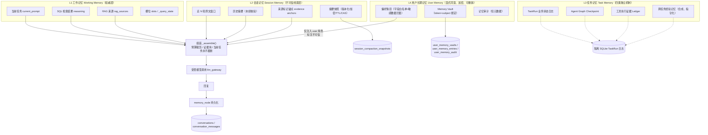
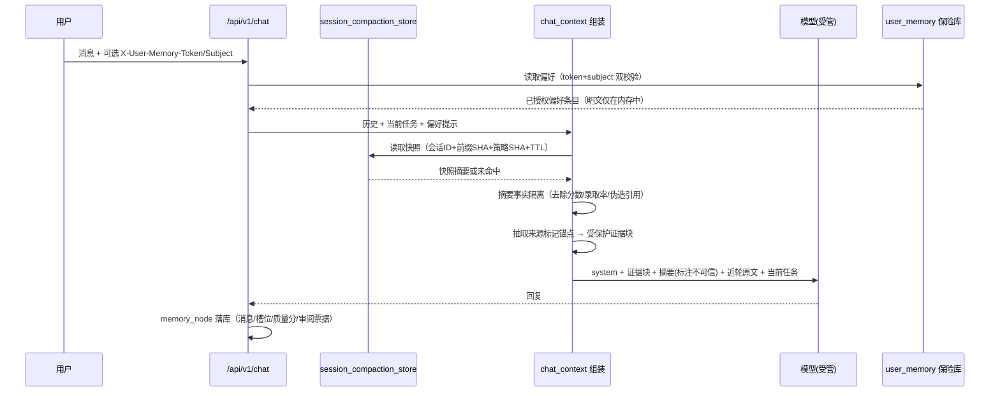

# 分层记忆生产化治理架构（2026-11-27）

> 本文是 Gaobao-Advisor 四层记忆的**当前**职责、边界、生命周期与门禁说明。
> 定位类历史快照（如 `memory-engineering-positioning-20261124.md`）保留原样，不回改。
> 状态口径遵循 `docs/PROJECT_STATUS.md`：IMPLEMENTED / INTEGRATED / VERIFIED /
> MERGED / PRODUCTION_VALIDATED 严格区分，合成测试不等于真实模型效果或生产验收。

> 实现：[PR #218](https://github.com/Xander-Xai/Gaobao-Advisor/pull/218)；
> 剩余门禁跟踪：[Issue #219](https://github.com/Xander-Xai/Gaobao-Advisor/issues/219)。

## 0. 一句话结论

四层记忆的**工程边界已经成立**：工作记忆以 SQL 证据为权威、会话记忆以不透明摘要降级、
任务级四类机制互不混淆、用户级记忆具备身份绑定、加密、审计与删除能力。
但**生产门禁仍然关闭**：真实身份、真实用户价值、备份保留与外部处理者仍无验收证据，
`USER_MEMORY_ENABLED` 保持"仅 development/test/local 且需显式开启"。

## 1. 四层架构

### 1.1 职责与不可逾越的边界

| 层 | 权威输入 | 可以做 | 绝对不能做 | 实现 |
|---|---|---|---|---|
| L1 工作记忆 | 当前请求、SQL 检索回执、来源标记 | 决定本次回答的事实基础 | 不被摘要/偏好覆盖 | `server/graph/nodes/llm_node.py`、`server/graph/nodes/memory.py` |
| L2 会话记忆 | 会话历史原文 + 不透明摘要 | 维持多轮理解、指代消解、偏好延续 | 不能生成招生事实、不能覆盖 L1、不能自证授权 | `server/agent/chat_context.py`、`memory_manager.py`、`durable_chat_context.py`、`session_compaction_store.py` |
| L3 任务记忆 | TaskRun 状态、检查点、工具账本、合成证据 | 恢复任务、重放校验、经验复用 | 不能跨权限读取、不能与 L4 混用 | `taskrun_store.py`、`synthetic_checkpoint.py`、`deepagents_tool_ledger.py`、`governed_evidence_memory.py` |
| L4 用户长期记忆 | 用户显式确认的偏好条目 | 跨会话个性化表达与筛选偏好 | 不能存分数/证件/联系方式/家庭信息、不能成为指令、不能作为招生事实 | `server/user_memory.py`、`user_memory_policy.py`、`user_memory_crypto.py`、`routes/user_memory.py` |

### 1.2 L3 的四类机制必须分开看（历史混淆点）

| 机制 | 是什么 | 存储 | 生命周期 | 与用户记忆的关系 |
|---|---|---|---|---|
| TaskRun 业务状态 | 一次研究任务的业务状态机（claim/lease/取消栅栏/回执） | 隔离 SQLite 日志（`SYNTHETIC_TASKRUN_JOURNAL`） | 任务级，随任务结束或人工维护清理 | 无关，不可作为用户偏好来源 |
| Agent Graph Checkpoint | LangGraph 节点级恢复点（可从某节点续跑） | 隔离 SQLite（`SYNTHETIC_DEEPAGENTS_CHECKPOINT_DB`） | 任务级 | 无关 |
| 工具执行证据 | 工具调用的摘要链式账本（digest 链、只追加） | 隔离 SQLite | 任务级 | 无关 |
| 跨任务经验记忆 | 合成证据指针（maker-checker、TTL、指针非内容） | 隔离 SQLite `synthetic_evidence_memory` | TTL 默认 24h | 属"经验"而非"用户偏好"，与 L4 分表分权限 |

结论：**单机任务执行已满足当前业务需求，不实现分布式 Graph Checkpoint**。只有出现真实的
跨进程恢复需求时，才按增量方式设计，不做预防性复杂度。

## 2. 数据流（L2 组装路径）

组装规则（`server/agent/chat_context.py`）：

1. **当前任务永不截断**：预算不足时抛 `ChatContextError`，而不是裁剪当前问题或 SQL 证据。
2. **证据块不可截断**：被压缩掉的旧轮次中助手引用过的来源标记（`（来源：…）`）以受保护块
   形式追加到当前任务前，随历史一起保留。
3. **摘要是不透明线索**：以 user 角色注入，带"未经核验"横幅，不得作为事实或指令。
4. **摘要失败安全降级**：摘要不可用时保留近轮原文并显式标注"上下文不完整"，绝不静默假装完整。
5. **摘要事实隔离**（`server/agent/memory_evidence.py`）：摘要中出现分数线/录取率/位次/
   投档线/百分比/保上类断言，或伪造 `（来源：…）` 引用时，整行替换为屏蔽标记；
   快照复用时再次隔离（纵深防御）。
6. **快照一致性**：快照绑定 `conversation_id + covered_count + covered_sha256 + policy_sha256`，
   读取时再次校验数据库已提交前缀；写入使用 CAS 版本号。
7. **快照加密与轮换**：AES-GCM，AAD 绑定会话/覆盖数/前缀/策略；`GAOBAO_CHAT_SNAPSHOT_KEY`
   为当前密钥，`GAOBAO_CHAT_SNAPSHOT_PREVIOUS_KEYS` 为只读退役密钥，轮换不需要销毁历史。

## 3. 存储矩阵

| 层 | 表/文件 | 内容 | 加密 | 过期 | 删除触发 |
|---|---|---|---|---|---|
| L1 | `conversations`、`conversation_messages` | 对话原文、槽位 | 否（库级加密由运维负责） | 无 TTL，会话级 | `DELETE /api/v1/profile/{session_id}/data` |
| L1 | `quality_scores`、`highlights`、`feedbacks`、`chat_turn_receipts` | 质量与回执 | 否 | 无 | 同上 |
| L2 | `session_compaction_snapshots` | 版本化摘要 | 是（AES-GCM，可轮换） | TTL 1–168h（默认 24h） | 随会话级联删除；worker 定期 prune |
| L3 | 隔离 SQLite：`synthetic_task_runs`、`synthetic_portfolio_reviews`、`synthetic_evidence_memory` | 任务状态/证据指针 | 否 | 证据记忆 TTL 24h | 任务维护接口 / `prune_expired` |
| L4 | `user_memory_vaults` | token 摘要、subject 指纹、同意时间与版本 | 否（只存摘要与指纹） | 无 TTL | `DELETE /api/v1/memory/vault` |
| L4 | `user_memory_entries` | 偏好值 | 是（AES-GCM，AAD 绑定 vault+key，密钥可轮换） | TTL 1–365 天（默认 180 天） | 条目删除 / 保险库擦除 / subject 擦除 / worker prune |
| L4 | `user_memory_audit` | 同意/写入/更新/删除/轮换/擦除事件（无值、无令牌、无 subject） | 否 | 审计保留 365 天 | worker prune |

迁移：`20261127_0010_user_memory_production.py`（唯一 head，仍为 `20261127_0010`）。

## 4. 权限矩阵

| 能力 | 匿名访客 | 会话持有者 | 记忆凭证 + subject 持有者 | 管理员 | 服务端/worker |
|---|---|---|---|---|---|
| 读取会话原文 | 否 | 是（本会话） | 否 | 需受控后台 | 是 |
| 读取会话摘要快照 | 否 | 是（经快照绑定校验） | 否 | 需受控后台 | 是 |
| 创建记忆保险库 | 否 | 否 | 是（需显式 `consent=true`） | 否 | 否 |
| 读取偏好条目 | 否 | 否 | 是（token+subject 双校验） | 需受控后台 | 是 |
| 写入/更新偏好 | 否 | 否 | 是（逐条显式确认 + CAS 版本） | 否 | 否 |
| 删除偏好条目 | 否 | 否 | 是（需匹配存活版本） | 需受控后台 | 是（过期清理） |
| 轮换记忆凭证 | 否 | 否 | 是（旧凭证立即失效） | 需受控后台 | 否 |
| 擦除整个保险库 | 否 | 否 | 是 | 需受控后台 | 是（subject 级） |
| 读取记忆审计 | 否 | 否 | 是（仅元数据） | 需受控后台 | 是 |
| 注入偏好到提示词 | 否 | 否 | 是（user 角色 + 不可信标注） | 否 | 是 |
| 从对话自动提取记忆 | — | — | — | — | **未实现，且默认禁止** |

跨用户隔离由三重约束保证：token 摘要（256 位随机）、subject 指纹（服务端 HMAC）、
`vault_id` 行级归属。任一不匹配返回 401，不泄露"是否存在"。

## 5. 生命周期

| 动作 | L1 | L2 | L3 | L4 |
|---|---|---|---|---|
| 写入 | 每轮落库消息+槽位 | 快照发布（CAS） | 任务状态/账本 | 显式写入 + 审计 |
| 读取 | 直接读 | 校验前缀 SHA/策略/TTL 后读 | 按 run_id + 租约读 | token+subject 校验后解密 |
| 更新 | 追加消息、更新槽位 | 覆盖前缀 + 版本 +1 | 状态机推进 | CAS 版本 +1；TTL 续期 |
| 过期 | 无（随会话） | TTL 到期不可读，后台物理删除 | 证据记忆 TTL | TTL 到期不可读，后台物理删除 |
| 删除 | 会话删除级联 | 随会话删除级联 | 任务维护接口 | 条目/保险库/subject 三级删除 |

## 6. 路径分类（避免把实验当业务）

| 路径 | 状态 | 开关 |
|---|---|---|
| 聊天主链路（历史→组装→模型→落库→会话删除） | **真实业务路径** | 无开关，始终可用 |
| 工作记忆 SQL 证据与来源标记 | **真实业务路径** | 无开关 |
| 会话快照（版本化/加密/TTL/CAS） | 业务可用，**默认关闭** | `GAOBAO_CHAT_COMPACTION_ENABLED` + `GAOBAO_CHAT_SNAPSHOT_ENABLED`（非开发环境强制拒绝） |
| 跨任务偏好保险库 | **开发/测试路径，默认关闭** | `USER_MEMORY_ENABLED` + `APP_ENV ∈ {development,dev,test,testing,local}` |
| 偏好后台清理 | 运维路径 | `GAOBAO_USER_MEMORY_MAINTENANCE_ENABLED` |
| TaskRun / DeepAgents 实验面 | **合成实验路径** | `ENABLE_SYNTHETIC_AGENT_EXPERIMENT`、`SYNTHETIC_TASKRUN_JOURNAL` |
| 合成证据记忆 | **合成实验路径** | 依赖 TaskRun 开关 |
| 真实模型记忆评测 | **未实现** | `benchmarks/memory_eval.py --execute` 当前直接拒绝执行 |
| 账号体系 / 实名认证 | **不存在** | 仅使用会话能力 + 伪匿名 subject |
| 对话自动抽取长期记忆 | **有意不实现** | 需单独授权与隐私评审 |
| 分布式 Graph Checkpoint | **有意不实现** | 无跨进程恢复需求 |

## 7. 生产门禁

| 门禁 | 当前状态 | 解除条件 |
|---|---|---|
| 真实身份绑定 | **未通过**：仅有伪匿名 subject | 真实账号/实名体系，或经评审的最小可靠身份方案 |
| 用户间数据隔离 | 通过（合成验证） | 真实多用户压测与审计复核 |
| 同意 / 撤销 / 审计 | 通过（合成验证） | 真实用户可用性评审 + 法务确认 |
| 字段白名单与数据分类 | 通过 | 分类表随业务演进复审 |
| 敏感个人信息防护 | 通过（合成验证） | 真实数据抽样误判率评估 |
| 数据库加密与密钥轮换 | 通过（实现 + 单测） | 运维密钥托管与轮换演练 |
| 修改 / 删除 / 全部遗忘 | 通过（实现 + 单测） | 备份与外部处理者联调 |
| 过期后台清理 | 通过（worker 接线 + 单测） | 运维调度与监控接入 |
| 账号删除与记忆删除一致性 | 部分通过：subject 擦除等价路径 | 真实账号体系建立后重做 |
| 备份保留周期与删除流程 | **未通过**：见 `docs/audits/2026-11-27-memory-production-audit.md` | 备份保留策略落地并演练 |
| 记忆凭证轮换与失效验证 | 通过（实现 + 单测） | 线上演练 |
| 记忆不得成为高权限指令或招生事实 | 通过（写入拦截 + 提示词中和 + 测试） | 真实模型对抗复核 |
| 真实模型记忆效果 | **NOT_MEASURED** | 真实 provider A/B + 人工复核 + 独立评审 |

**结论：在上表两项"未通过"和一项"NOT_MEASURED"解除之前，`USER_MEMORY_ENABLED` 保持生产关闭。**

## 8. 剩余风险

1. **subject 是伪匿名标识**：客户端可自行生成，无法防止同一自然人用两个 subject 建两套记忆，
   也无法防止不同自然人共用一个 subject。只能保证"不同 subject 之间不串数据"。
2. **旧库明文偏好**：`20261127_0010` 之前写入的条目保持明文以免丢数据，
   由 `scripts/rekey_user_memory.py` 重写；重写前这些行在读取结果中标记 `LEGACY_PLAINTEXT`。
3. **备份与外部处理者**：库内加密不覆盖数据库备份、日志、文件系统快照与模型供应商请求。
4. **模型侧残留**：偏好与摘要会随提示词发送给模型供应商，属于"已授权但外部处理"，
   需在供应商协议与隐私声明中覆盖。
5. **会话层仍无真实成本数据**：摘要调用是额外付费调用，受管网关限额，但真实账单未测。
