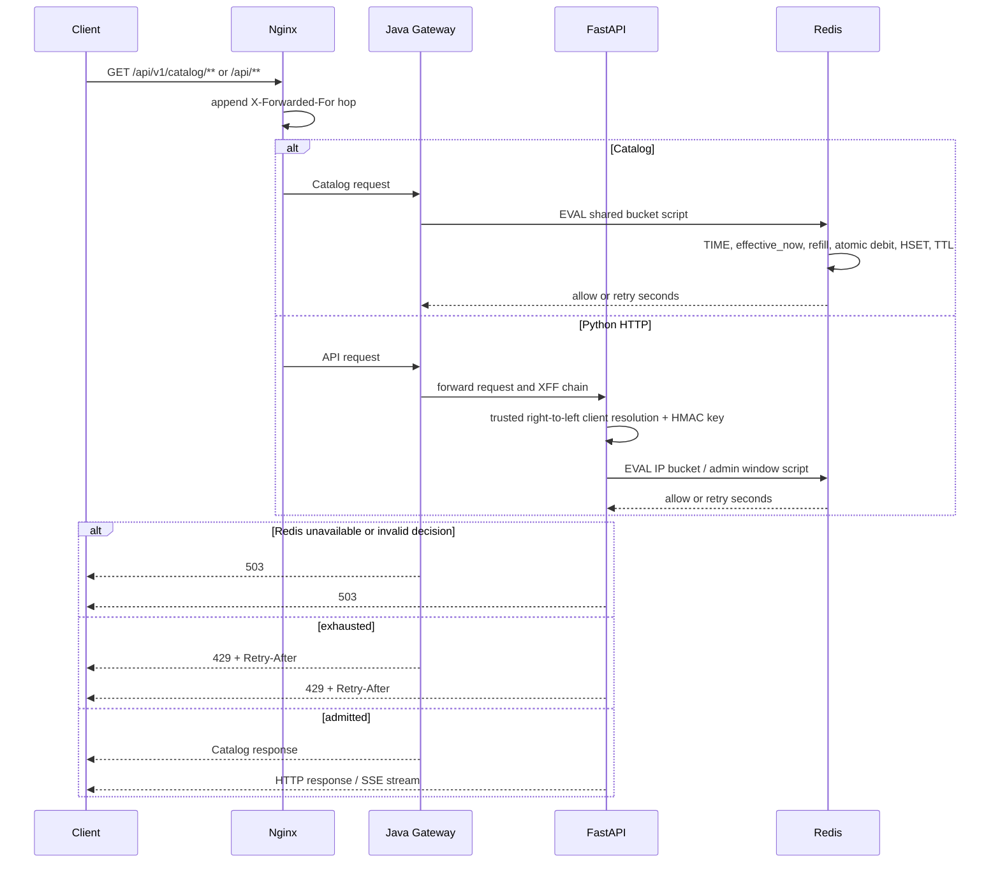

# Industrial public HTTP admission

## Rate-limit ownership and scope

| Surface | Mechanism | Identity / budget | Boundary |
| --- | --- | --- | --- |
| `GET /api/v1/catalog/**` | Java Gateway Redis/Lua token bucket | One fixed key shared by all Gateway replicas | Global Catalog capacity protection, not a per-user or per-IP quota. The Gateway Catalog route does not also pass through FastAPI. |
| Other Industrial FastAPI HTTP routes | Python Redis/Lua token bucket | HMAC of the trusted-proxy-resolved client IP | Public HTTP abuse protection across API replicas. Rate and burst are configured by `PUBLIC_API_RATE_PER_SECOND` and `PUBLIC_API_RATE_BURST`; all replicas must match. |
| Administrator login and quality-job creation | Redis sorted-set sliding windows | Login: client IP and username; jobs: client IP and authenticated username | Route-specific brute-force/operation controls. They layer with the broad Python IP bucket; the controls have separate purposes and thresholds. |
| SSE chat | Python public HTTP token bucket | Same IP bucket as the HTTP request | One admission per request/stream start. It does not limit individual SSE events or concurrent open streams. |
| WebSocket voice `/ws/call` | Not released in Industrial | No message budget | Industrial Nginx returns 404 without proxying, and FastAPI retains its Industrial handshake rejection. Non-Industrial compatibility use remains outside the Industrial release contract. |
| LLM provider RPM, TPM, model concurrency | GA01 | GA01's quota identity | Do not duplicate provider-cost or model-concurrency quotas in these HTTP limiters. |

The public limits are intentionally not one universal threshold. Java protects shared Catalog capacity; FastAPI provides an IP baseline; administrator sliding windows add operation-specific protections. There is no authenticated-user quota or independent high-cost route budget in this change.

## Trusted proxy and client identity

`resolve_client_ip()` ignores forwarding headers unless the direct peer is in an explicitly configured trusted network. For a trusted proxy chain it scans `X-Forwarded-For` from right to left, skips configured proxy hops, and selects the nearest untrusted address. Thus a caller-controlled leftmost value does not choose its own bucket identity.

The Java Nginx overlay appends its immediate peer with `$proxy_add_x_forwarded_for`; it does not replace the chain with a proxy address. The Industrial Compose profile now requires `TRUSTED_PROXIES` and the runtime validates that the setting contains valid CIDRs. Configure only the actual Java Gateway and upstream ingress proxy hops needed for the deployment's chain. If the legacy `ADMIN_TRUSTED_PROXIES` is also set, it takes precedence in the shared resolver; Industrial startup requires it to match `TRUSTED_PROXIES`. Do not trust an entire private address space merely for convenience.

When a proxy is missing from the allowlist, the resolver safely uses the direct peer instead of trusting XFF. This avoids spoof-based bypass but may collapse callers behind the same Gateway address into one rate bucket. The live TLS/edge topology and exact CIDRs remain a production acceptance item; the local standalone tests do not establish an operator's real proxy chain.

## Atomic token bucket and time behavior

Each token-bucket decision is one Redis Lua transaction: read Redis `TIME` and the bucket, calculate refill, debit one token if available, persist tokens/time, and refresh the TTL. Java Catalog and Python public HTTP use matching logical-time behavior:

```text
effective_now = max(redis_now, previous_updated)
elapsed = min(max(0, effective_now - previous_updated), capacity / rate)
tokens = min(capacity, previous_tokens + elapsed * rate)
updated = effective_now
```

The timestamp cannot move backward, so a later recovery from a clock rollback cannot replay the same refill interval. During rollback, refill pauses until Redis time catches the stored timestamp. A forward jump may refill the bucket, but never beyond configured capacity. A forward jump long enough to expire the Redis key, explicit key loss, Redis restart without persistence, or replication loss may reset a bucket to its initial full capacity.

Redis `TIME` is a shared wall clock, not an absolute monotonic clock. A Redis primary/replica failover with asynchronous replication can lose recent limit state and admit up to another configured burst; these limiters do not provide absolute strong consistency under failover. The production persistence/replication model must be documented and tested by the deployment owner.

The administrator Lua sliding window keeps its sorted-set design. Before pruning or recording a request it uses `window_now = max(redis_now_ms, newest_event_score)`. A request admitted during a clock rollback therefore receives the newest existing logical score instead of a smaller wall-clock score that could be pruned too early after time recovers. Key expiry/state loss still resets its window; a large forward clock jump can age entries out early.

## HTTP responses and failure policy

- Bucket exhaustion returns 429 with an integer `Retry-After`, rounded up to the time needed to earn one token (minimum one second).
- Redis timeout, disconnection, script failure, malformed result/state, or empty decision returns 503. Industrial does not fall back to per-process memory.
- The two internal health probes keep their own dependency semantics and are exempt from the Industrial public token bucket.
- The local/development profile keeps the existing in-process token bucket; its results are not distributed Redis evidence.

## Evidence and remaining gates

**Verification record (2026-11-28):** `tests/test_admin_limits_redis.py` ran 18 tests against an isolated Redis 7.4.9 standalone container; token bucket rollback/recovery for both Python and Java Lua source, admin window rollback, multi-instance/process atomicity, capacity, IP isolation, state loss, corrupt state, and middleware HTTP decisions passed. The combined focused Python suite with Redis ran 58 tests; the repository-wide Python run is recorded below. No `FLUSHDB`/`FLUSHALL`, shared Redis clock changes, or production credentials were used.

Repository-wide `uv run pytest -q` then passed **1,942 tests**, skipped **52** external/optional cases, and reported **82.90%** coverage against the 70% gate. The 18 Redis integration tests were separately run with `REDIS_TEST_URL` against Redis 7.4.9, rather than counted among those skipped default-suite cases.

`uv run --extra worker python3 scripts/verify_java_distributed_ci.py public-rate-limit-lifecycle` exercises the production `RateLimitMiddleware` over FastAPI `TestClient` and an owned volatile Redis container: `200, 200, 429` with `Retry-After: 1000`; Redis stop returns 503; restart with persistence disabled returns `200, 200, 429` after state loss. This is a short correctness/fault probe, not a throughput measurement or the main Industrial application.

The Java Lua text block was extracted from the Java Gateway source and executed against real Redis with a test-only replacement of the Redis `TIME` read; rollback, refill cap, and corrupt-state cases passed. The exact PR head was also built by CI: Java Maven verification and Java/MySQL/Redis/Python Compose smoke both passed on GitHub Actions run [46047930404](https://github.com/Xander-Xai/Gaobao-Advisor/actions/runs/46047930404), including the two-Gateway/Redis fault path and Nginx `/ws/` check. The Compose dataset is synthetic and its public Python bucket is process-local; it is not the Industrial Redis per-IP profile.

The local environment has no JDK/Maven, and its Maven/JDK image pull failed with a Docker Registry TLS handshake timeout; GitHub Actions supplied the successful Java verification. The main Industrial API was not started because no approved data manifest or external credentials were supplied. Java Catalog and standard-profile Python service load results are recorded with exact limits and synthetic-data caveats in [the performance acceptance record](../performance/java-python-load.md); those numbers do not measure Industrial Python's Redis-backed IP bucket or production capacity.

Managed primary/replica failover and async replication loss are untested; standalone Redis does not prove HA. Active SSE concurrency, actual trusted proxy CIDRs/TLS chain, formal WebSocket message budgets, production capacity and persistence/RPO remain release gates.

## Interview walkthrough



Core lines to explain:

```lua
local effective_now = math.max(now, updated)
local elapsed = math.min(math.max(0, effective_now - updated), capacity / rate)
tokens = math.min(capacity, tokens + elapsed * rate)
redis.call('HSET', key, 'tokens', tokens, 'updated', effective_now)
```

`effective_now` prevents a Redis clock rollback from moving state backward; the elapsed refill cap bounds arithmetic to the time needed for a full bucket; `min(capacity, ...)` enforces the configured burst. A later forward discontinuity can fill one burst, while replication/key loss may reset to a full bucket. This is not a monotonic-clock or strong-consistency guarantee.
